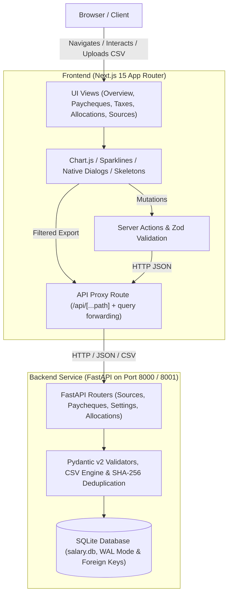

# Payday: Salary & Income Management App — Project Overview

> **Payday** is a precision personal salary and income tracking platform. It lets users log take-home paycheques and full paystub breakdowns, manage diversified income sources (jobs, government benefits, contractor work), analyze tax withholdings and reserves, split deposits into pay-yourself-first buckets, project upcoming paydays, and benchmark progress against annual goals.

---

## 1. Executive Summary

Payday is engineered for clean, exact visibility into net and gross earnings from the **income side** of personal finance:

- **Integer-Cents Precision**: All monetary amounts (`amount_cents`, `gross_cents`, `tax_cents`, `deductions_cents`, `goal_cents`) and rates (`tax_reserve_bps`, `weight_bps`) are stored and calculated as exact integers, eliminating floating-point rounding drift.
- **Paystub & Contractor Tax Intelligence**: Optional Gross Pay, Income Tax Withheld, and Deductions tracking alongside automatic contractor tax reserve set-aside calculations.
- **Pay-Yourself-First Allocations**: Deterministic integer-cent distribution across custom spending, savings, and investment buckets using the Largest Remainder Method.
- **Explicit Schedules & Predictive Paydays**: Per-source `pay_schedule` support (`auto`, `weekly`, `biweekly`, `semimonthly`, `monthly`, `irregular`) with 1-click `"Log"` prefill from the dashboard.
- **Bidirectional CSV Workflows**: Query-filtered CSV export with formula-injection protection and idempotent SHA-256 deduplicated bulk CSV import.

When launched against an empty database, the backend seeds historical earnings data (Kung Fu Tea, Softchoice Co-op, CRA / Government benefits) matching records from `Salary.pdf`.

---

## 2. System Architecture & Tech Stack



### Technology Highlights

- **Frontend**:
  - **Framework**: [Next.js 15](https://nextjs.org/) (App Router, React 19, Server Components & Client Components).
  - **Language**: TypeScript (strict typing across domain types, actions, services, and Zod schemas).
  - **Styling**: [Tailwind CSS v4](https://tailwindcss.com/) (`@theme inline`, `@layer base`, `@layer components` in `frontend/src/styles/globals.css`), Outfit + DM Mono fonts, `tabular-nums`, native `<dialog>` modals, and global `prefers-reduced-motion: reduce` support.
  - **Visualizations**: [Chart.js 4](https://www.chartjs.org/) (stacked bar + target line, cumulative + goal-pace line, source split doughnut) and interactive CSS sparklines.
  - **Validation**: [Zod](https://zod.dev/) schemas validating every Server Action payload.
- **Backend**:
  - **Framework**: Modular FastAPI architecture with SQLAlchemy 2.0 Async, Pydantic v2, and aiosqlite (`backend/src/`).
  - **Database**: SQLite with Write-Ahead Logging (`PRAGMA journal_mode = WAL`), `PRAGMA busy_timeout = 5000`, strict foreign keys (`PRAGMA foreign_keys = ON`), and idempotent startup schema migrations (`ensure_schema_migrations`).
- **Containerization**:
  - **Docker Compose**: Multi-container `frontend` (Node 22 Alpine, port `8080->3000`) and `backend` (non-root Python 3.13-slim with healthcheck, port `8001->8000`) backed by persistent `payday-data` volume.

---

## 3. Comprehensive Feature Breakdown

### 3.1. Overview Dashboard (`/`)

| Feature Component | Description |
| :--- | :--- |
| **Hero Total Counter** | Displays total net income for the active period with an animated cubic-eased count-up (`HeroTotalCounter`) that automatically disables under `prefers-reduced-motion`. |
| **Year-over-Year Delta** | Compares earnings against the prior year up to the exact calendar date (`▲ +X%` or `▼ -X%`). |
| **Year Switcher (`YearDropdown`)** | Styled native `<select>` inside the Hero pill showing each year's labeled net subtotal (`Net $X`), updating `?year=` cleanly with full keyboard/Escape/ARIA support. |
| **First-Run Onboarding** | When `paycheques.length === 0`, renders a focused **Get Started in 3 Steps** card guiding users through adding a source, logging/importing a first paycheque, and setting a goal or allocation plan. |
| **Executive KPI Cards** | Displays Monthly Average, Best Month, Paycheque Count (and average), and Top Source share. |
| **Goal Pace Overlays & Projections** | `MonthlyIncomeChart` overlays a dashed monthly target line (`goal / 12`), `CumulativeIncomeChart` overlays an annual linear goal pace curve, and the Yearly Goal card shows an inline `▲ ahead / ▼ behind pace` dollar delta alongside projected year-end totals and monthly runway. |
| **Actionable Next Paydays (`UpcomingPaydaysList`)** | Predicts upcoming dates using each source's explicit `pay_schedule` (after 1 paycheque) or 3-cheque median-gap detection (`auto`), highlights due/late dates, and includes a 1-click **Log** button that opens `PaychequeDialog` prefilled with the source, date, and estimated amount. |
| **Source Split & Records** | Source distribution doughnut chart, all-time milestones scorecard, and the 5 most recent paycheques. |

---

### 3.2. Paycheques Ledger (`/paycheques`)

| Feature Component | Description |
| :--- | :--- |
| **Hierarchical Monthly Ledger** | Groups paycheques by calendar month with monthly deposit counts and subtotals. |
| **URL-Synced Filters** | Filters by **Year**, **Source**, and **Search** (`Note, source, or amount…`), synced to URL query parameters (`?year=&source=&q=`) via `window.history.replaceState` with a 1-click **Clear filters** reset. |
| **Inline Allocation & Reserve Splits** | Expandable `Split` panel on rows with active allocation buckets or contractor tax reserves, complete with 1-click **Copy** buttons (`(cents / 100).toFixed(2)`) for quick banking transfers. |
| **Filtered CSV Export** | Downloads `/api/export.csv` scoped to active `year`, `source_id`, and `q` filters (`Export filtered CSV (N)`), with spreadsheet formula-injection escaping (`_safe_csv_cell`). |
| **Idempotent Bulk CSV Import** | `CsvImportDialog` uploads `.csv` files (with sample template download and auto-create source option) to `POST /api/paycheques/import`, validating rows atomically and skipping duplicates via deterministic SHA-256 `import_hash` (`source_id:paid_on:amount_cents`). |

---

### 3.3. Gross-to-Net & Tax Intelligence (`/taxes`)

- **True Spendable Net Hero**: Shows net income minus contractor tax reserve set-asides and net retention rate.
- **Retention Bar & Partial-Coverage Alignment**: Uses matching semantic tokens (`--up`, `--warn`, `--down`) across bar segments and legend items. When only some paycheques have gross paystub breakdowns logged, the retention bar aligns 1:1 with tracked stubs and notes coverage (`Based on X of Y paycheques with gross pay logged`).
- **Source Treatment & Paystub Breakdown Tables**: Separates source withholding (`W-2` / `T4`) from untaxed contractor sources (`1099` / `T4A` reserve rates) and lists detailed gross/tax/deduction/reserve breakdowns per stub.

---

### 3.4. Pay-Yourself-First Allocations (`/allocations`)

- **Bucket Rules & Largest Remainder Split**: Allocates True Spendable Net across `essentials`, `investments`, `savings`, and `lifestyle` buckets up to 100% (`10000` bps) with exact cent conservation.
- **Guarded Presets**: One-click templates (`50-30-20`, `student-coop`, `aggressive-saver`) protected by `window.confirm()` when existing buckets would be replaced.
- **Split & Hourly Wage Simulator**: Interactive direct-deposit and hourly-rate (`$/h × hours`) split previewer.

---

### 3.5. Income Sources (`/sources` & `/sources/[id]`)

- **Accessible Source Cards (`SourceCardShell`)**: Full-card stretched `<Link>` overlay (`Cmd/Ctrl+Click` and keyboard support), accessible contrast labels, elevated `z-10` 12-month sparkline bars with hover dollar tooltips (`data-tip`), and dedicated `Edit` triggers.
- **Source Drilldown (`/sources/[id]`)**: Per-source Hero total, share of income, cadence/upcoming estimate, KPI cards (average, monthly average, best month, hourly net/gross rates), monthly chart, year-by-year breakdown bar, records, and searchable source ledger.

---

### 3.6. Interactive Dialogs & Accessibility

| Component | Key Capabilities |
| :--- | :--- |
| **`PaychequeDialog`** | Source chips (`+ New source` inline shortcut), take-home input, collapsible paystub breakdown drawer (`Gross`, `Tax`, `Deductions`) with live auto-net sync & discrepancy alert, live `$/h` preview, `"Same as last time"` preset, `"Save & add another"` batch mode, 0-source guard, double-submit pending state (`Saving…` / `Deleting…`), split summary toast, and 7-second delete Undo. |
| **`SourceDialog`** | Name, kind (`job`, `government`, `other`), native `<input type="color">`, `Pay Schedule` selector, tax treatment (`withheld` vs. `untaxed` reserve presets), archive toggle, pending state, and 2-step delete confirmation (`Delete source` → `Confirm delete?`) with relational delete protection. |
| **`GoalDialogTrigger`** | Set, update, or remove yearly take-home goals with pending/disabled guards. |
| **Navigation & Loading** | Persistent `?year=` links across tabs in `Navbar`, horizontally scrollable mobile nav pills, structural route skeletons (`skeleton.tsx`, `loading.tsx`), skip-to-content link, `global-error.tsx` / `not-found.tsx` heading hierarchy, and touch-gated <kbd>N</kbd> shortcut hints. |

---

## 4. Data Integrity & Business Rules

1. **Integer Cents & Basis Points**: Currency values (`amount_cents`, `gross_cents`, `tax_cents`, `deductions_cents`, `goal_cents`) and percentages (`tax_reserve_bps`, `weight_bps`) are persisted as integers.
2. **Database Integrity Constraints**:
   - `sources`: Unique case-insensitive `name` (`COLLATE NOCASE`), `kind IN ('job', 'government', 'other')`, `is_tax_withheld IN (0, 1)`, `tax_reserve_bps BETWEEN 0 AND 6000`, `pay_schedule IN ('auto', 'weekly', 'biweekly', 'semimonthly', 'monthly', 'irregular')`.
   - `paycheques`: `FOREIGN KEY (source_id) REFERENCES sources(id) ON DELETE RESTRICT`, `date(paid_on) = paid_on`, `amount_cents > 0`, `gross_cents IS NULL OR gross_cents >= amount_cents`, `tax_cents >= 0`, `deductions_cents >= 0`, `hours > 0`, and partial unique index `idx_paycheques_import_hash` on `import_hash WHERE import_hash IS NOT NULL`.
   - `allocation_rules`: Unique case-insensitive `name` (1–50 chars), `category IN ('essentials', 'investments', 'savings', 'lifestyle')`, `weight_bps BETWEEN 1 AND 10000`, 6-digit hex `color`, `active IN (0, 1)`, and total active sum `<= 10000` bps enforced by API service logic.
3. **Transaction Safety**: Mutations and batch CSV imports run inside async SQLAlchemy transactions with rollback on `IntegrityError`.

---

## 5. API Reference

| Method | Endpoint | Description | Request / Query | Response |
| :--- | :--- | :--- | :--- | :--- |
| `GET` | `/api/health` | Health check probe | *None* | `{"ok": true}` |
| `GET` | `/api/state` | Full application snapshot | *None* | `{ sources, paycheques, settings, allocations }` |
| `GET` | `/api/export.csv` | Download filtered or full CSV | `?year=YYYY&source_id=N&q=...` | Streamed UTF-8 CSV |
| `GET` | `/api/paycheques` | List paycheques (desc) | *None* | `PaychequeResponse[]` |
| `POST` | `/api/paycheques` | Create a paycheque | `{ source_id, paid_on, amount, gross?, tax?, deductions?, hours?, note? }` | `{"id": int}` |
| `POST` | `/api/paycheques/import` | Atomic idempotent CSV import | `{ csv_text?, rows?, auto_create_sources }` | `{ ok, imported_count, skipped_duplicates, created_sources, error_count, errors }` |
| `PUT` | `/api/paycheques/{id}` | Update a paycheque | Same as create payload | `{"ok": true}` |
| `DELETE` | `/api/paycheques/{id}` | Delete a paycheque | *None* | `{"ok": true}` |
| `GET` | `/api/sources` | List all income sources | *None* | `SourceResponse[]` |
| `POST` | `/api/sources` | Create an income source | `{ name, kind, color, archived, is_tax_withheld, tax_reserve_bps, pay_schedule }` | `{"id": int}` |
| `PUT` | `/api/sources/{id}` | Update an income source | Same as create payload | `{"ok": true}` |
| `DELETE` | `/api/sources/{id}` | Delete a source (blocked if paycheques exist) | *None* | `{"ok": true}` |
| `PUT` | `/api/settings` | Set or clear yearly income goal | `{"goal": string\|number\|null}` | `{"ok": true}` |
| `GET` | `/api/allocations` | List allocation rules & totals | *None* | `{ allocations, total_active_bps, unallocated_bps }` |
| `POST` | `/api/allocations` | Create an allocation rule | `{ name, category, weight_bps\|percentage, color, sort_order, active }` | `{"id": int}` |
| `PUT` | `/api/allocations/{rule_id}` | Update an allocation rule | Same as create payload | `{"ok": true}` |
| `DELETE` | `/api/allocations/{rule_id}` | Delete an allocation rule | *None* | `{"ok": true}` |
| `POST` | `/api/allocations/presets` | Replace rules with a preset | `{"preset": "50-30-20"\|"student-coop"\|"aggressive-saver"}` | `{"ok": true, "count": int}` |

---

## 6. Directory Structure

```text
Salary_Management_App/
├── backend/
│   ├── test_app.py                     # Async backend integration & invariant tests
│   ├── Dockerfile                      # Non-root Python 3.13-slim container with healthcheck
│   ├── pyproject.toml                  # FastAPI / SQLAlchemy / Ruff / Pytest config
│   └── src/
│       ├── main.py                     # FastAPI app, lifespan, CORS, health check
│       ├── config.py                   # AppConfig settings & SQLite URL
│       ├── database.py                 # Async SQLite engine, WAL pragmas, migrations & seeding
│       ├── exceptions.py               # Domain exception types & handlers
│       ├── models.py                   # SQLAlchemy Base & shared Pydantic response models
│       ├── allocations.py              # AllocationRule model, Largest Remainder & router
│       ├── paycheques/                 # Paycheque models, schemas, router, CSV import/export service
│       ├── settings/                   # Goal settings & full-state snapshot domain
│       └── sources/                    # Source models, schedules, schemas, router, service
├── frontend/
│   ├── Dockerfile                      # Multi-stage Next.js standalone build
│   ├── package.json                    # Next.js 15, React 19, Chart.js 4, Zod, Tailwind CSS v4
│   ├── next.config.mjs                 # Next.js config
│   └── src/
│       ├── app/
│       │   ├── layout.tsx              # Root HTML shell & fonts
│       │   ├── global-error.tsx        # Root error boundary
│       │   ├── not-found.tsx           # 404 page
│       │   ├── (dashboard)/
│       │   │   ├── layout.tsx          # Dashboard shell, Navbar & global dialogs
│       │   │   ├── loading.tsx         # Structural dashboard skeleton
│       │   │   ├── page.tsx            # Overview dashboard
│       │   │   ├── paycheques/page.tsx # Paycheques ledger page
│       │   │   ├── taxes/page.tsx      # Tax intelligence page
│       │   │   ├── allocations/page.tsx# Allocations & simulator page
│       │   │   └── sources/
│       │   │       ├── page.tsx        # Sources grid page
│       │   │       └── [id]/
│       │   │           ├── loading.tsx # Structural source-detail skeleton
│       │   │           └── page.tsx    # Source drilldown page
│       │   └── api/[...path]/route.ts  # Backend proxy forwarding path + query string
│       ├── components/
│       │   ├── layout/navbar.tsx       # Year-preserving navigation & skip link
│       │   └── ui/                     # DialogProvider, YearDropdown, Skeleton
│       ├── features/
│       │   ├── allocations/            # Allocation buckets, presets & simulator
│       │   ├── overview/               # Charts, KPIs, onboarding, goal dialog & upcoming paydays
│       │   ├── paycheques/             # Ledger, PaychequeDialog, CsvImportDialog & actions
│       │   ├── sources/                # SourceCardShell, sparklines, SourceDialog & detail views
│       │   └── taxes/                  # Gross-to-net retention bar & tax tables
│       ├── lib/                        # Allocation engine, tax intelligence, DB client, utils
│       ├── styles/globals.css          # Tailwind v4 theme tokens, base & component layers
│       └── types/payday.ts             # Shared domain TypeScript interfaces
├── features/                           # Feature specifications
├── improvement-plan/                   # Master UI/UX improvement blueprint
├── refactor/                           # UX pain-point analyses
├── ui-audit/                           # UI craft & accessibility audit findings
├── docker-compose.yml                  # Multi-container orchestration
├── PROJECT_OVERVIEW.md                 # Architecture & feature overview
└── README.md                           # Quick start & reference
```

---

## 7. Setup & Execution

### Option A: Running with Docker Compose (Recommended)

```bash
docker compose up -d --build
```

- Frontend: `http://localhost:8080` (configurable via `PAYDAY_PORT`)
- Backend API: `http://localhost:8001` (configurable via `BACKEND_PORT`)
- Persistent SQLite data is stored in the `payday-data` volume (`/data/salary.db`).

### Option B: Running Locally

1. **Start Backend**:
   ```bash
   cd backend
   pip install -e ".[dev]"
   fastapi dev src/main.py --port 8001
   ```

2. **Verify Backend Tests & Lint**:
   ```bash
   cd backend
   pytest
   ruff check .
   ```

3. **Start Frontend & Verify Build**:
   ```bash
   cd frontend
   npm install
   npm run typecheck
   npm run dev
   # Runs on http://localhost:3000
   ```
