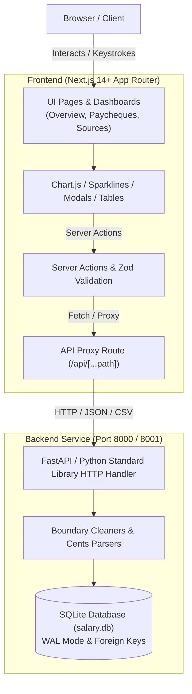

# Payday: Salary & Income Management App — Project Overview

> **Payday** is a high-performance, precision personal salary and income tracking platform. It allows users to track take-home paycheques, manage diversified income sources (jobs, government benefits, side gigs), analyze historical trends, project upcoming paydays, and benchmark progress against annual financial goals.

---

## 1. Executive Summary

Payday was engineered to provide clean, accurate, and instant visibility into net take-home earnings. Unlike traditional budgeting apps that focus heavily on expense categorization and bank synchronizations, Payday focuses deeply on the **income side** of personal finance:
- Exact deposit records stored in integer cents (eliminating floating-point rounding errors).
- Algorithmic payday cadence detection (predicting when the next cheque arrives and for how much).
- Annual financial goal tracking with real-time pace and required runway projections.
- In-depth source analytics with hourly take-home wage calculations.
- Zero-friction data management with global keyboard shortcuts, undoable operations, and CSV export.

The application comes pre-seeded with historical earnings data (e.g. Kung Fu Tea, Softchoice Co-op, CRA / Government benefits) matching verified records from `Salary.pdf`.

---

## 2. System Architecture & Tech Stack



### Technology Highlights
- **Frontend**:
  - **Framework**: [Next.js](https://nextjs.org/) (App Router, React Server Components & Client Components).
  - **Language**: TypeScript (strict typing across domain models, actions, and schemas).
  - **Visualizations**: [Chart.js](https://www.chartjs.org/) (interactive stacked bar charts, multi-year cumulative line charts, source share doughnut charts) and custom CSS-grid sparkline bars.
  - **Validation**: [Zod](https://zod.dev/) schemas enforcing type safety on every server mutation.
  - **Design System**: Bespoke vanilla CSS fintech design system (Outfit typography, DM Mono tabular numerals, custom CSS variables, dark radial hero banners, responsive mobile-first grid, accessible `:focus-visible` styling, and `prefers-reduced-motion` compliance).
- **Backend**:
  - **Core Service**: High-speed, zero-dependency Python standard library server (`http.server`, `sqlite3`, `decimal`, `csv`, `json`), running with sub-millisecond execution overhead.
  - **Modern Architecture Extension**: Modular FastAPI architecture with SQLAlchemy 2.0 Async, Pydantic v2, and Aiosqlite (`backend/src/`).
  - **Database**: SQLite with Write-Ahead Logging (`PRAGMA journal_mode = WAL`) and strict foreign key enforcement (`PRAGMA foreign_keys = ON`).
- **Containerization**:
  - **Docker Compose**: Orchestrates multi-container frontend and backend services with persistent named Docker volume (`payday-data`).

---

## 3. Comprehensive Feature Breakdown

### 3.1. Overview Dashboard (`/`)

The primary executive dashboard provides instant financial awareness, high-level metrics, and visualization curves.

| Feature Component | Description |
| :--- | :--- |
| **Hero Total Counter** | Displays total net income for the selected timeframe. Features an animated cubic-eased count-up animation (`requestAnimationFrame`) that automatically honors the user's `prefers-reduced-motion` settings. |
| **Comparative Delta Badge** | Computes year-over-year pacing against the previous year up to the exact calendar date (`▲ +X%` or `▼ -X%`), giving an instant indicator of financial trajectory. |
| **Multi-Year Dropdown** | Allows instantaneous switching between specific years (e.g., 2026, 2025) or "All Time". Each dropdown option displays its subtotal, updating URL query parameters (`?year=...`) without hard page reloads. |
| **Executive KPI Cards** | Four summary cards showing:<ul><li>**Monthly Average**: Total income divided by active earning months.</li><li>**Best Month**: Peak earnings month and its dollar total.</li><li>**Paycheque Count**: Total deposits and the arithmetic average per deposit.</li><li>**Top Source**: Highest-grossing employer/payer and its percentage of the total pool.</li></ul> |
| **Monthly Income by Source Chart** | Stacked bar chart (powered by Chart.js) color-coded by income source. Displays total monthly take-home earnings with interactive tooltip breakdowns and monthly summary footers. |
| **Yearly Goal & Pacing Engine** | Interactive goal progress card:<ul><li>Displays current progress bar against user-configured yearly take-home target.</li><li>**Pacing Projection**: Projects year-end earnings based on daily velocity (`(goalSum / daysDone) * daysInYr`).</li><li>**Runway Metric**: Computes remaining dollars required per month (`goalLeft / monthsLeft`) to hit target, or announces early achievement.</li></ul> |
| **Predictive Payday Engine** | Algorithmic forecasting module (`computeUpcomingPaydays`) that evaluates the median gap across past deposits to predict the next payout date, relative countdown ("today", "tomorrow", "in X days"), and estimated payout amount. |
| **Cumulative Trajectory Chart** | Running total line chart comparing the active year's curve against the previous year's full progression, or rendering all-time cumulative growth. |
| **Source Split Doughnut Chart** | Visual breakdown of income distribution across all active payers with percentage shares. |
| **All-Time Records & Milestones** | Dedicated scorecard displaying: All-time earnings, tracking start date, all-time best month record, and biggest single deposit in app history. |
| **Recent Deposits Stream** | List of the 5 most recent paycheques with source color dots, notes, and one-click edit dialog triggers. |

---

### 3.2. Paycheques Management & Ledger (`/paycheques`)

A comprehensive, searchable, and exportable ledger of every individual deposit.

| Feature Component | Description |
| :--- | :--- |
| **Hierarchical Monthly Ledger** | Deposits are grouped by calendar month with clean monthly headers displaying the month name, deposit count, and monthly subtotal. |
| **Live Multi-Criteria Filtering** | Instant client-side filtering without server roundtrips:<ul><li>**Year Filter**: All years or specific year.</li><li>**Source Filter**: All sources or specific income stream.</li><li>**Full-Text Search**: Matches against notes, source names, amounts, or ISO dates.</li></ul> |
| **Detailed Column Attributes** | Displays payment date (with weekday), source indicator, custom deposit notes (e.g., "Co-op term", "Tax refund"), logged hours worked, and net take-home amount. |
| **Summary Table Footer** | Dynamically recalculates total paycheques matching the active filter and the running monetary sum. |
| **One-Click CSV Export** | `/api/export.csv` streaming endpoint that downloads a formatted CSV file (`paycheques-YYYY-MM-DD.csv`) containing `date, source, amount, hours, note` for accounting or tax filing. |

---

### 3.3. Income Sources Management (`/sources`)

Dedicated management hub for employers, government benefit programs, freelance clients, and side hustles.

| Feature Component | Description |
| :--- | :--- |
| **Source Card Grid** | Each source is rendered as an interactive card branded with its custom accent color. |
| **12-Month Sparkline Bars** | Custom CSS-grid rolling 12-month activity bar chart embedded directly inside each source card, complete with year span indicators and hover tooltips showing exact monthly earnings. |
| **Source Statistics** | Highlights all-time cumulative earnings, total paycheques received, average deposit amount, and last paid date. |
| **Hourly Rate Intelligence** | When hours are logged on deposits, the app calculates the effective net take-home wage per hour (`timedCents / timedHours`) and total hours logged. |
| **Categorization & Archival** | Sources are categorized as `Job`, `Government`, or `Other`. Inactive or finished positions can be marked as `Archived`, preserving historical records while removing them from quick-entry menus. |

---

### 3.4. Source Detail & Analytics (`/sources/[id]`)

A deep-dive view into a specific income stream with granular performance analytics.

| Feature Component | Description |
| :--- | :--- |
| **Source Branded Hero** | Dynamic color gradient banner displaying total source earnings, percentage share of total income, active date range, and year-specific filtering. |
| **Cadence & Schedule Analysis** | Determines day-of-the-week deposit patterns (e.g., "Usually paid on Fridays") and median recurring cycles (e.g., "~14-day cycle"). |
| **Performance KPIs** | Key metrics tailored to the source: Average deposit, deposit range (minimum to maximum deposit), monthly average, and best month ever recorded. |
| **Source Monthly Bar Chart** | Dedicated monthly chart illustrating seasonal or monthly variations for that specific payer, including tooltip metrics for paycheque counts and hours worked. |
| **Yearly Breakdown Comparison** | List showing total income per year with horizontal percentage progress bars and quick links to toggle year-specific source views. |
| **Milestone Quick Actions** | Clickable buttons highlighting the "Biggest Deposit" and "Smallest Deposit" that instantly open the respective paycheque for inspection or modification. |
| **Source-Specific Ledger** | Ledger filtered exclusively to this source with:<ul><li>In-ledger search bar.</li><li>Monthly groupings with monthly hour subtotals.</li><li>**"vs. Avg" Delta Analysis**: Custom pill indicator comparing each deposit to the source average (`+X%` green, `-X%` red, or `Avg`).</li><li>Effective hourly wage pill per cheque (`$X.XX/h`).</li></ul> |

---

### 3.5. Interactive Dialogs & CRUD Workflows

| Modal Dialog | Functionality & UX Innovations |
| :--- | :--- |
| **Paycheque Dialog**<br/>*(Add / Edit)* | <ul><li>Accessible `<dialog>` modal with backdrop blur.</li><li>Source selector chips featuring custom color dots.</li><li>**"+ New source" Shortcut**: Ability to create a brand-new source directly from inside the paycheque modal without losing entered details.</li><li>Large, tabular currency input with automatic decimal formatting.</li><li>**"Same as last time" Quick Button**: One-click preset button populating the exact dollar amount of the previous paycheque from that source.</li><li>HTML5 date selector defaulting to today or the paycheque's date.</li><li>Optional decimal hours input and optional note field (up to 200 characters).</li><li>**Delete with Instant Undo**: Deleting a paycheque presents a 7-second notification toast with an "Undo" action that seamlessly restores the record.</li></ul> |
| **Source Dialog**<br/>*(Add / Edit)* | <ul><li>Name input (up to 60 characters) with uniqueness enforcement.</li><li>Kind selector (`job`, `government`, `other`).</li><li>Interactive color picker automatically picking an unused accent color from the default palette.</li><li>Archive toggle checkbox.</li><li>**Relational Safety**: Deletion is blocked if the source contains associated paycheques (with an explicit prompt to archive instead).</li></ul> |
| **Yearly Goal Dialog** | <ul><li>Quick modal to set or update the annual take-home dollar target.</li><li>"Remove goal" button to clear existing goals.</li><li>Live updates across all overview dashboard pacing widgets.</li></ul> |

---

### 3.6. Productivity, Accessibility & UX Details

- **Global Keyboard Shortcut**: Press <kbd>N</kbd> on any screen (when not typing in an input field or viewing an open modal) to immediately trigger the "Add paycheque" dialog.
- **Accessible Toast System**: Non-intrusive floating toast notifications with ARIA live regions (`role="status"`, `aria-live="polite"`), auto-dismissing after 3 seconds (or 7 seconds when an Undo action is available).
- **Deep-Linking & Hash Navigation**: Integrated hash listener (`#add`, `#overview`, `#paycheques`, `#sources`, `#source/:id`) supporting direct URL sharing, browser bookmarking, and instant modal triggers.
- **Accessibility (a11y)**:
  - Skip to main content link (`.skip`).
  - High-visibility focus indicators (`:focus-visible`).
  - Clear ARIA roles on custom controls (`role="listbox"`, `role="img"`, `role="alert"`).
  - Screen-reader accessible hidden captions and tables.
- **Full Responsive Design**: Fluid grid layouts that adjust seamlessly from wide desktop monitors down to mobile screens (1024px and 720px breakpoints), featuring full-width touch buttons and collapsible navigation tabs.

---

## 4. Data Integrity & Business Rules

1. **Integer Cents Representation**: All monetary quantities (`amount_cents`, `goal_cents`) are strictly handled and stored as integers to eliminate floating-point calculation errors. Conversion to formatted dollars occurs only at presentation boundaries.
2. **Database Integrity Constraints**:
   - `sources.name`: Unique, case-insensitive collation (`COLLATE NOCASE`).
   - `sources.kind`: Strict check constraint (`CHECK (kind IN ('job', 'government', 'other'))`).
   - `paycheques.source_id`: Foreign key with `ON DELETE RESTRICT` preventing accidental orphaned records.
   - `paycheques.paid_on`: Strict ISO date format constraint (`CHECK (date(paid_on) = paid_on)`).
   - `paycheques.amount_cents`: Positive integer constraint (`CHECK (amount_cents > 0)`).
   - `paycheques.hours`: Positive float constraint (`CHECK (hours IS NULL OR hours > 0)`).
3. **Transaction Safety**: All writes utilize atomic database transactions (`c.commit()` or rollback on exception).

---

## 5. API Reference

All endpoints return JSON responses (with the exception of `/api/export.csv`) and support CORS.

| Method | Endpoint | Description | Request Payload | Response |
| :--- | :--- | :--- | :--- | :--- |
| `GET` | `/api/health` | Health check probe | *None* | `{"ok": true}` |
| `GET` | `/api/state` | Full application snapshot (sources, paycheques, settings) | *None* | `{ sources: [...], paycheques: [...], settings: {...} }` |
| `GET` | `/api/export.csv` | Download complete paycheque ledger as CSV | *None* | Streamed CSV file |
| `POST` | `/api/paycheques` | Record a new paycheque | `{"source_id": int, "paid_on": "YYYY-MM-DD", "amount": string\|number, "hours": number\|null, "note": string}` | `{"id": int}` |
| `PUT` | `/api/paycheques/:id` | Update an existing paycheque | `{"source_id": int, "paid_on": "YYYY-MM-DD", "amount": string\|number, "hours": number\|null, "note": string}` | `{"ok": true}` |
| `DELETE` | `/api/paycheques/:id` | Delete a paycheque by ID | *None* | `{"ok": true}` |
| `POST` | `/api/sources` | Create a new income source | `{"name": string, "kind": "job"\|"government"\|"other", "color": "#hex", "archived": int\|bool}` | `{"id": int}` |
| `PUT` | `/api/sources/:id` | Update an existing income source | `{"name": string, "kind": "job"\|"government"\|"other", "color": "#hex", "archived": int\|bool}` | `{"ok": true}` |
| `DELETE` | `/api/sources/:id` | Delete an income source (blocked if paycheques exist) | *None* | `{"ok": true}` |
| `PUT` | `/api/settings` | Set or remove annual income goal | `{"goal": string\|number\|null}` | `{"ok": true}` |

---

## 6. Directory Structure

```
Salary_Management_App/
├── backend/
│   ├── app.py                  # Zero-dependency Python HTTP & SQLite service
│   ├── test_app.py             # Backend integrity and seeding tests
│   ├── Dockerfile              # Minimal Python 3.13-slim container
│   ├── pyproject.toml          # FastAPI/SQLAlchemy project configuration
│   └── src/                    # Domain-driven FastAPI modules
│       ├── config.py           # Application settings & DB URLs
│       ├── models.py           # SQLAlchemy declarative bases & Pydantic models
│       ├── paycheques/         # Paycheque domain models, schemas, and utils
│       └── sources/            # Source domain models, schemas, and services
├── frontend/
│   ├── Dockerfile              # Multi-stage Next.js production build container
│   ├── package.json            # Node.js dependencies (Next.js, Chart.js, Zod)
│   ├── next.config.mjs         # Next.js compiler settings
│   └── src/
│       ├── app/
│       │   ├── layout.tsx                      # Root HTML shell & fonts
│       │   ├── (dashboard)/
│       │   │   ├── layout.tsx                  # Dashboard layout, dialogs & navigation
│       │   │   ├── page.tsx                    # Overview dashboard page
│       │   │   ├── paycheques/page.tsx         # Paycheques ledger page
│       │   │   └── sources/
│       │   │       ├── page.tsx                # Sources grid page
│       │   │       └── [id]/page.tsx           # Source drilldown detail page
│       │   └── api/[...path]/route.ts          # Backend API proxy handler
│       ├── components/
│       │   ├── layout/navbar.tsx               # Navigation bar & quick add button
│       │   └── ui/                             # YearDropdown, DialogProvider, toasts
│       ├── features/
│       │   ├── overview/                       # Overview charts, KPIs, and goal actions
│       │   ├── paycheques/                     # Paycheque ledger, dialog, and actions
│       │   └── sources/                        # Source cards, detail views, and charts
│       ├── lib/                                # DB client, env validation, formatting utils
│       └── styles/globals.css                  # Modern fintech styling & responsive design
├── docker-compose.yml          # Containerized multi-service configuration
├── Salary.pdf                  # Historical salary source reference
└── PROJECT_OVERVIEW.md         # Full application documentation
```

---

## 7. Setup & Execution

### Option A: Running with Docker Compose (Recommended)
```bash
docker-compose up --build
```
- Frontend will be accessible at: `http://localhost:8080` (or `$PAYDAY_PORT`)
- Backend will be accessible at: `http://localhost:8001` (or `$BACKEND_PORT`)
- Data is safely persisted across container rebuilds via the `payday-data` volume.

### Option B: Running Locally

1. **Start Backend**:
   ```bash
   cd backend
   python app.py
   # Runs on http://localhost:8000 (seeds database automatically from Salary.pdf data)
   ```

2. **Verify Backend Tests**:
   ```bash
   python backend/test_app.py
   ```

3. **Start Frontend**:
   ```bash
   cd frontend
   npm install
   npm run dev
   # Runs on http://localhost:3000
   ```
