# Feature 6 — Superior Multi-Format Paycheque Ingestion Specification

- **Date:** 2026-11-20
- **Status:** Implemented & Verified (commits `1060caa`, `b9f12af`)
- **Target Project:** Payday (Salary & Income Management App)
- **Objective:** Upgrade Payday's CSV-only bulk import into a dynamic, 100% local, CPU-friendly multi-format ingestion pipeline supporting spreadsheets (`.csv`, `.tsv`, `.xlsx`), digital paystub PDFs (`.pdf`), scanned PDFs, and paystub images (`.png`, `.jpg`, `.jpeg`, `.webp`) under a **< 1 GB** local model footprint—without breaking Payday's integer-cents precision or SHA-256 deduplication.

---

## Agent Directives & Invariants

1. **Leave `POST /api/paycheques/import` untouched:** The existing import endpoint handles atomic SQLAlchemy transactions, integer-cents conversion (`parse_cents`), source auto-creation, and deterministic SHA-256 deduplication (`source_id:paid_on:amount_cents`). Stage 1 (`POST /api/paycheques/parse`) writes nothing to SQLite and normalizes uploads into editable `ParsedPaychequeRow[]` candidates for review before committing through `POST /api/paycheques/import`.
2. **Integer-Cents Precision:** Never persist floating-point currency math. Monetary strings extracted by parsers, OCR, or the local LLM are normalized via `parse_cents` / `Decimal` (`ROUND_HALF_UP`) and checked against `validate_paystub_breakdown` (`amount_cents > 0`, `gross_cents >= amount_cents`, `tax_cents + deductions_cents <= gross_cents - amount_cents`).
3. **Sub-1 GB Local Footprint on CPU:** No PyTorch (`torch`) or heavy vision-language models. Tier 3 runs on CPU inside the `python:3.13-slim` container using `rapidocr>=3.4.0` + `onnxruntime>=1.20.0` (installed via the optional `ocr` extra, replacing `rapidocr-onnxruntime` which lacks Python 3.13 wheels) and `Qwen2.5-0.5B-Instruct` GGUF `Q4_K_M` (~491 MB) via `llama-cpp-python>=0.3.0`.
4. **Non-Blocking FastAPI Event Loop:** CPU-bound work (`openpyxl`, `pdfplumber`, `pypdfium2`, `RapidOCR`, `llama-cpp-python`) runs inside `asyncio.to_thread(...)`, and `llama-cpp-python` inference is serialized with `_LLM_LOCK` (`threading.Lock`) inside `extractors.llm_extract`.
5. **Frontend Standards:** Next.js 15 App Router, React 19, strict TypeScript, Tailwind CSS v4 using Payday's cool-white-slate tokens (`--bg`, `--surface`, `--card`, `--ink`, `--muted`, `--line`, `--accent`, `--up`, `--warn`, `--down`, `.num`), Zod validation, and native `<dialog>` elements honoring `prefers-reduced-motion`.

---

## 1. Overview & Two-Stage Architecture

### Problem Solved
Previously, Payday only accepted strictly formatted `.csv` files (`CsvImportDialog` → `POST /api/paycheques/import`). Real-world pay data arrives as spreadsheets with varied column names (`.csv`, `.tsv`, `.xlsx`), multi-table payroll PDFs (PeopleSoft/Sheridan College, Workday, ADP, Dayforce), scanned PDFs, and phone photos/screenshots.

### Implemented Pipeline
1. **Stage 1 (`POST /api/paycheques/parse`)**: Inspects magic bytes, queries existing `Source.name` records for employer matching, runs the appropriate parser tier, extracts tables/summary headers/dates/currency, validates exact-cent breakdown math, and returns `ParseResponse` (`rows: ParsedPaychequeRow[]`, `parser_used`, `used_llm_fallback`, `unmapped_columns`).
2. **Stage 2 (`ImportDialog` → `importPaychequesAction` → `POST /api/paycheques/import`)**: Displays a cancelable loading state while parsing, lets the user review and edit every row inline with live Zod validation, and commits valid rows atomically through the existing idempotent import endpoint.

```mermaid
flowchart LR
    File["User Upload\n(.csv, .tsv, .xlsx, .pdf, .png, .jpg, .webp)"] --> Proxy["Next.js Proxy\ndb.proxy() via arrayBuffer()"]
    Proxy --> ParseAPI["FastAPI\nPOST /api/paycheques/parse"]

    subgraph Backend ["backend/src/paycheques/ (parsers.py + extractors.py)"]
        Detect["detect_mime()\nMagic Bytes + Null-Byte Guard"]
        T1["Tier 1: parse_table()\n.csv, .tsv, .xlsx + FIELD_ALIASES"]
        T2["Tier 2: pdf_extract()\npdfplumber text + extract_tables()"]
        T3["Tier 3: ocr_text()\npypdfium2 (1.75x) + 1800px cap + RapidOCR"]
        DetRules["Deterministic Paystub Rules\n_fields_from_tables -> _fields_from_summary_lines\n-> _TEXT_PATTERNS -> _infer_source_name"]
        LLM["_compact_for_llm() -> llm_extract()\nQwen2.5-0.5B Q4_K_M + _sanitize_llm_fields()"]
        Check["check_row()\nExact-Cent Math & Confidence"]
    end

    ParseAPI --> Detect
    Detect --> T1 & T2 & T3
    T2 -->|"text < 20 chars (scanned PDF)"| T3
    T2 & T3 --> DetRules
    DetRules -->|"warnings remain"| LLM
    DetRules -->|"0 warnings"| Check
    LLM --> Check
    T1 --> Check
    Check -->|"ParseResponse"| UI["Frontend ImportDialog\nCancelable Loader + Inline Review Table"]
    UI -->|"importPaychequesAction + Zod"| ImportAPI["Existing POST /api/paycheques/import\nAtomic SQLite + SHA-256 Dedup"]
```



---

## 2. 3-Tier Parsing Strategy

| Tier | Supported Formats | Primary Engine | Escalation / Fallback |
| :--- | :--- | :--- | :--- |
| **Tier 1: Tabular** | `.csv`, `.tsv`, `.xlsx` | Stdlib `csv` + `openpyxl` (`read_only=True, data_only=True`) with punctuation-normalized `FIELD_ALIASES`; notes truncated to `MAX_NOTE_LENGTH` (`200`). | Unmapped column names returned in `unmapped_columns` and shown above the review table; requires at least a date or amount column (`400` otherwise). |
| **Tier 2: Digital PDF** | Selectable-text `.pdf` | `extractors.pdf_extract()` (max `5` pages) capturing both `extract_text()` and ruled `extract_tables()`, then deterministic extraction (`_fields_from_tables` → `_fields_from_summary_lines` → `_TEXT_PATTERNS` + `_PAID_ON_NEXTLINE_RE` + `_DIST_TOTAL_RE` → `_infer_source_name`). | If extracted text `< 20` chars (scanned PDF), escalates to **Tier 3**. Only invokes **Qwen2.5-0.5B** if deterministic extraction still leaves `warnings`. |
| **Tier 3: Scanned PDF & Images** | Scanned `.pdf`, `.png`, `.jpg`, `.jpeg`, `.webp` | `pypdfium2` (`OCR_PDF_SCALE = 1.75`, max `2` pages), Pillow LANCZOS downscale to `MAX_OCR_IMAGE_PX = 1800`, `RapidOCR` (`onnxruntime`) with median-line-height `_visual_lines()` row sorting, then the shared deterministic paystub rules. | If deterministic extraction leaves `warnings`, calls **Qwen2.5-0.5B-Instruct (`Q4_K_M`)** on `_compact_for_llm()` (`1,800` chars max) with `gross`-before-`amount` JSON schema (`max_tokens=140`) and `_sanitize_llm_fields()`, ranking regex-only vs. merged vs. LLM-only candidates. |

### Deterministic Paystub Extraction & Current vs. YTD Disambiguation
Real payroll PDFs and OCR screenshots (such as PeopleSoft/Sheridan College, ADP, Workday, and Dayforce stubs) place summary labels on one line and `Current:` vs. `YTD:` figures below them, alongside distractor figures like `CIT TAXABLE GROSS` and date ranges like `Pay Begin Date` / `Pay End Date`. To avoid slow and error-prone small-LLM calls whenever deterministic structure is present:
- **`_fields_from_tables()`** maps ruled `pdfplumber` table headers via `_SUMMARY_CELL_MAP`, skips unmapped columns (`CIT TAXABLE GROSS`, `Taxable Gross`), handles both multi-row and newline-packed `"Current:\nYTD:"` cells, and picks the `Current` / `This Period` row before `YTD`.
- **`_fields_from_summary_lines()`** tokenizes horizontal summary headers on plain PDF text or RapidOCR `_visual_lines` (using explicit `_skip_*` capture groups so `CIT TAXABLE GROSS`, `Taxable Gross`, `Pre-Tax Deductions`, and `After-Tax Deductions` keep column counts aligned 1:1 with values on the `Current:` line).
- **`_TEXT_PATTERNS` & fallbacks** match `Advice Date`, `Check/Cheque Date`, `Issue Date`, `Pay Date`, `Payment Date`, `Date Paid`, `Deposit Date`, and `Pay Day` (never `Pay Begin/End Date`), fall back to next-line dates (`_PAID_ON_NEXTLINE_RE`), and check `NET PAY DISTRIBUTION ... TOTAL` (`_DIST_TOTAL_RE`) when `amount` is absent.
- **`_infer_source_name()`** checks existing Payday `Source.name` values from SQLite (longest first, word-boundary match in the first 1,500 chars) before falling back to the top-left employer line.
- **`_sanitize_llm_fields()`** guards against 0.5B copy-collapse when the LLM *does* run—clearing `tax` / `deductions` if `gross >= amount` yet `tax + deductions > gross - amount`.

---

## 3. Backend Implementation

### Module Layout
```text
backend/
├── Dockerfile                         # Two-stage build + checksum-pinned GGUF & RapidOCR warmup
├── pyproject.toml                     # Core deps (openpyxl, pdfplumber) + optional [ocr] extra
├── test_app.py                        # Integration & parser unit tests
└── src/
    ├── config.py                      # AppConfig.QWEN_MODEL_PATH
    └── paycheques/
        ├── constants.py               # MAX_UPLOAD_BYTES = 10 * 1024 * 1024
        ├── exceptions.py              # UnsupportedFileType (415), FileTooLarge (413)
        ├── schemas.py                 # ParsedPaychequeRow, ParseResponse
        ├── router.py                  # POST /api/paycheques/parse (queries Source.name list)
        ├── extractors.py              # pdf_extract, ocr_text, _visual_lines, _compact_for_llm, llm_extract
        └── parsers.py                 # detect_mime, normalizers, check_row, parse_table, row_from_text, parse_upload
```

### Dependencies & Configuration
- **`backend/pyproject.toml`**:
  - Core dependencies add `"openpyxl>=3.1.5"` and `"pdfplumber>=0.11.4"`.
  - `[project.optional-dependencies]` defines `ocr = ["llama-cpp-python>=0.3.0", "onnxruntime>=1.20.0", "rapidocr>=3.4.0"]` so local test environments without C++/ONNX runtimes still boot cleanly and degrade gracefully (`ModuleNotFoundError` → HTTP `400` plain error).
- **`backend/src/config.py`**:
  - `QWEN_MODEL_PATH: str = "/opt/models/qwen2.5-0.5b-instruct-q4_k_m.gguf"` (if the file is missing or unreadable, `extractors.llm_available()` returns `False`).
- **`backend/src/paycheques/constants.py` & `exceptions.py`**:
  - `MAX_UPLOAD_BYTES = 10 * 1024 * 1024` (10 MB).
  - `UnsupportedFileType` (`415`) and `FileTooLarge` (`status.HTTP_413_CONTENT_TOO_LARGE`) extend `AppError`, returning Payday's standard `{"error": "..."}` JSON payload.

### API Contract (`POST /api/paycheques/parse`)
- Accepts `file: UploadFile`, injects `db: DBDep`, reads up to `MAX_UPLOAD_BYTES + 1` bytes (`413` if exceeded, `400` if empty), queries `[Source.name]` for known-source matching, and returns `ParseResponse`:
  - `filename: str`, `detected_mime: str`, `parser_used: "tabular" | "pdf_text" | "ocr"`, `used_llm_fallback: bool`, `rows: ParsedPaychequeRow[]`, `unmapped_columns: str[]`.
  - `ParsedPaychequeRow` holds normalized strings (`source_name`, `paid_on` as `YYYY-MM-DD`, `amount`/`gross`/`tax`/`deductions` as `"1842.50"` decimal strings), `hours: float | None`, `note: str | None`, `confidence: float` (`0.0..1.0`), and `warnings: list[str]`.
  - Any unexpected parser failure is logged and converted to a plain `400` (`BadRequestError`).

### Local LLM Tuning (`extractors.py`)
- `_llm()` initializes `Llama` lazily (`@cache`) with `n_ctx=1536`, `n_threads=min(os.cpu_count() or 4, 4)`, `n_batch=512`, `chat_format="chatml"`, `verbose=False` (container benchmarks showed `4` threads outperformed `2` and `8` on 0.5B CPU inference).
- `PAYSTUB_JSON_SCHEMA` orders fields `("source_name", "paid_on", "gross", "tax", "deductions", "amount", "hours")` so `gross` is generated before `amount`, paired with `max_tokens=140` and `_compact_for_llm()` (`MAX_LLM_CHARS = 1800`).

### Docker Image (`backend/Dockerfile`)
- **Stage 1 (`builder`, `python:3.13-slim`)**: Installs `build-essential` and `cmake`, extracts `dependencies + optional-dependencies.ocr` from `pyproject.toml` into `requirements.txt`, and compiles wheels with `CMAKE_BUILD_PARALLEL_LEVEL=8` into `/wheels` (only invalidated when `pyproject.toml` changes).
- **Stage 2 (runtime, `python:3.13-slim`)**: Installs `libgomp1`, downloads `qwen2.5-0.5b-instruct-q4_k_m.gguf` into `/opt/models/` via checksum-pinned `ADD --checksum=sha256:74a4da8c9fdbcd15bd1f6d01d621410d31c6fc00986f5eb687824e7b93d7a9db --chmod=644`, installs `/wheels` offline, pre-warms `RapidOCR()` ONNX weights into the image layer, runs `chmod 755 /opt/models` so non-root `appuser` can traverse `/opt/models`, and copies `src/`.

---

## 4. Frontend Implementation (Next.js 15)

### Module Layout
```text
frontend/src/
├── lib/db.ts                                          # MODIFY: req.arrayBuffer() in db.proxy()
├── styles/globals.css                                 # MODIFY: --animate-indeterminate keyframes
└── features/
    ├── overview/components/overview-dashboard.tsx     # MODIFY: Updated onboarding CTA copy
    └── paycheques/
        ├── schemas/import-schema.ts                   # NEW: Shared Zod row & batch validation
        ├── actions/import-paycheques.ts               # MODIFIED: Accepts validated ParsedRow[]
        └── components/
            ├── paycheque-ledger.tsx                   # MODIFY: Renders <ImportDialog sources={sources} />
            └── import-dialog.tsx                      # NEW: Unified upload/loading/review <dialog> (replaces csv-import-dialog.tsx)
```

### Proxy & Validation Boundaries
- **`frontend/src/lib/db.ts`**: `db.proxy` forwards request bodies with `await req.arrayBuffer()` instead of `await req.text()`, keeping `multipart/form-data` boundaries and binary files intact through the unchanged `app/api/[...path]/route.ts` route handler.
- **`frontend/src/features/paycheques/schemas/import-schema.ts`**:
  - `importRowSchema` validates `source_name` (`1..60`), `paid_on` (`YYYY-MM-DD`), `amount` (`> 0`), optional `gross` / `tax` / `deductions` / `hours` / `note` (`<= 200`), and runs an integer-cent `.superRefine(...)` matching backend rules (`gross > 0`, `gross >= amount`, `tax + deductions <= gross - amount`).
  - `importRowsSchema` validates `{ rows (1..5000), auto_create_sources }` inside `importPaychequesAction` (`'use server'`).
- **`frontend/src/features/paycheques/actions/import-paycheques.ts`**: Posts validated `rows` to `POST /api/paycheques/import`, calls `revalidatePath('/', 'layout')`, and returns `PaychequeImportResult` (`{ ok, imported_count, skipped_duplicates, created_sources: number, error_count, errors: Array<{ row, error }> }`).

### Unified Dialog & Loading Experience (`import-dialog.tsx`)
- Styled exclusively with Payday's cool-white-slate tokens (`--bg`, `--surface`, `--card`, `--ink`, `--muted`, `--line`, `--accent`, `--accent-soft`, `--up`, `--warn`, `--down`, `.num`, `.btn`, `<dialog>`).
- **Upload step**: Drag-and-drop zone (`border-dashed`) + accessible `<input type="file" accept=".csv,.tsv,.xlsx,.pdf,.png,.jpg,.jpeg,.webp">` + sample CSV template download (`text-[13px]`).
- **Cancelable parsing loader**: During `pending === 'parse'`, an `AbortController` + 1s timer powers a status card (`role="status" aria-busy="true"`) showing a CSS spinner, filename & formatted size, live elapsed seconds (`.num`), an indeterminate `--accent` progress bar (`motion-safe:animate-indeterminate`, disabled automatically under `prefers-reduced-motion`), file-type-aware stage messages (e.g., `Reading PDF text and tables…` → `Checking layout and scanned pages…` → `Matching fields with local AI…`), and a 2-row `<Skeleton />` table preview. **Cancel** or `Escape` aborts in-flight parsing immediately.
- **Inline review step**: Shows filename, row count, detected tier (`spreadsheet`, `PDF text`, `scan (OCR)`), optional local-AI indicator, and `Ignored columns` notice; offers a bulk `"Source for rows without one"` `<select>` when any row lacks a source; renders editable inputs (with `<datalist>` source suggestions, `.num` inputs, status pills/dots, and per-row Remove); retains only failed rows with server errors on partial import failure; and fires a summary toast on completion.

---

## 5. Security, Resource Guardrails & Design Revisions

### Guardrails
- **Magic-Byte Validation:** File routing inspects `%PDF-`, `PK\x03\x04`, `\x89PNG\r\n\x1a\n`, `\xff\xd8\xff`, and `RIFF....WEBP`; `.csv`/`.tsv` require no `\x00` null bytes in the first 4 KB.
- **Resource Caps:** `10 MB` max upload (`413`), `5` PDF pages for text/table extraction, `2` PDF pages for OCR at `scale=1.75`, `1800px` max image side before OCR, `1,800` chars max compact prompt for Qwen (`n_ctx=1536`, `max_tokens=140`), `5,000` rows max per import commit.
- **Concurrency Safety:** `_LLM_LOCK` (`threading.Lock`) serializes calls to `Llama` inside `asyncio.to_thread`.

### Key Revisions from Original Draft & Deliberate Deferrals
- **Consolidated backend & frontend modules:** Replaced the proposed 11-file `parsers/` package with `parsers.py` + `extractors.py` (and kept `ImportReviewTable` inline inside `import-dialog.tsx`), avoiding premature abstraction.
- **Python 3.13 + self-contained Docker image:** Switched `rapidocr-onnxruntime` to `rapidocr>=3.4.0` + `onnxruntime` and baked the checksum-pinned GGUF weights into `/opt/models/` so `docker compose up` works with zero manual volume setup.
- **Deferred (YAGNI):**
  - *Interactive column-remapping UI:* Fuzzy `FIELD_ALIASES` + `unmapped_columns` + inline editing cover standard payroll/bank exports; add a column-mapping step only if arbitrary unaliased spreadsheets need it.
  - *Eager model warm-up on container boot:* Kept `@cache` lazy loading so idle RAM stays low when no OCR/LLM scans are used (~0.8s Qwen load / ~1.5s RapidOCR load on first scan).

---

## 6. Verification & Observed Benchmarks

### Checklist
- [x] Backend config, constants, exceptions, schemas, `pyproject.toml`, and two-stage `Dockerfile` (`chmod 755 /opt/models`).
- [x] `parsers.py`, `extractors.py`, and `POST /api/paycheques/parse` in `router.py` (without touching `POST /api/paycheques/import`).
- [x] Backend tests in `backend/test_app.py`:
  - `test_parse_upload_guards_and_fuzzy_spreadsheets` (magic-byte spoofing `415`, empty `400`, >10 MB `413`, fuzzy `.csv` / `.xlsx` headers, `check_row` math warnings, Stage 2 `/import` commit).
  - `test_parse_pdf_ocr_escalation_and_llm_fallback` (PDF text vs. OCR escalation, mocked LLM fallback, `_visual_lines` box grouping).
  - `test_peoplesoft_paystub_tables_known_sources_and_llm_guard` (Sheridan/PeopleSoft multi-line & ruled `pdfplumber` tables, `Advice Date`, DB `Source.name` matching, LLM math-collapse sanitization).
- [x] Frontend `db.proxy` `arrayBuffer()` passthrough, `import-schema.ts`, `import-paycheques.ts`, `import-dialog.tsx`, `globals.css`, and ledger/onboarding links (`CsvImportDialog` removed).

### Verification Commands & Results (Observed `2026-11-20`)
- `cd backend && ruff format --check ... && ruff check . && python3 -m pytest -q`: **18 passed**, `All checks passed!`.
- `cd frontend && npm run typecheck && npm run build`: exited `0`.
- `graphify update .`: rebuilt (`783` nodes, `1487` edges, `48` communities).
- `docker compose up -d --build && docker compose ps`: `backend` `Up (healthy)` (`8001->8000`), `frontend` `Up` (`8080->3000`).
- Live smoke tests via `http://127.0.0.1:8080/api/paycheques/parse` (Sheridan PeopleSoft paystub layout):
  - Digital `.pdf`: **174 ms**, `parser_used: "pdf_text"`, `used_llm_fallback: false` → `Sheridan College`, `2026-09-18`, Gross `142.78`, Tax `2.82`, Deductions `3.75`, Net `136.21`, `warnings: []`.
  - Rendered `.png`: **2.57 s**, `parser_used: "ocr"`, `used_llm_fallback: false` → exact same 6 fields, `warnings: []`.
