# Superior Import — Dynamic Multi-Format Paycheque Ingestion Specification

> **Target Project:** Payday (Salary & Income Management App)
> **Audience:** AI Coding Agent / Software Engineer
> **Objective:** Upgrade Payday's CSV-only bulk import into a dynamic, 100% local, CPU-friendly multi-format ingestion pipeline supporting spreadsheets (`.csv`, `.tsv`, `.xlsx`), digital paystub PDFs (`.pdf`), scanned PDFs, and photos of handwritten bank cheques or paper paystubs (`.png`, `.jpg`, `.jpeg`, `.webp`) under a **< 1 GB** local model footprint—without breaking Payday's integer-cents precision or SHA-256 deduplication.

---

## Agent Directives & Invariants (Read First)

Before writing or modifying any code, strictly adhere to these project invariants:

1. **Do NOT rewrite `POST /api/paycheques/import`**: The existing import endpoint already handles atomic SQLAlchemy transactions, integer-cents conversion, source auto-creation, and deterministic SHA-256 deduplication (`source_id:paid_on:amount_cents`). All new file parsers MUST normalize into a shared intermediate staging format (`ParsedPaychequeRow`) and let the user review/edit rows before submitting to `POST /api/paycheques/import`.
2. **Integer-Cents Precision**: Never persist floating-point currency math. All monetary strings extracted by parsers/OCR/VLMs must be sanitized via Python `Decimal` and validated before reaching SQLite (`gross_cents >= amount_cents`, `amount_cents > 0`, `tax_cents >= 0`, `deductions_cents >= 0`).
3. **Sub-1 GB Local Footprint (No PyTorch, No Fine-Tuning)**: Do NOT install PyTorch (`torch`) or attempt model fine-tuning. For handwritten cheques and scanned images, use **image preprocessing (auto-crop + CLAHE)** paired with a sub-1 GB multimodal OCR model (**GLM-OCR ~0.9B** or **Qwen3.5-0.8B** via Ollama / `llama.cpp` vision server), with `rapidocr-onnxruntime` (~150 MB) + `Qwen2.5-0.5B-Instruct` GGUF (~400 MB) as a pure-CPU fallback when no vision endpoint is configured.
4. **Non-Blocking FastAPI Event Loop**: CPU-bound operations (`pdfplumber`, `OpenCV`/Pillow preprocessing, `RapidOCR`, `llama-cpp-python`) MUST run inside `asyncio.to_thread(...)`, and `llama-cpp-python` inference MUST be serialized with an `asyncio.Lock()`.
5. **Frontend Standards**: Next.js 15 App Router, React 19, strict TypeScript, Tailwind CSS v4 (using existing semantic CSS tokens `--up`, `--warn`, `--down`, `tabular-nums`), Zod validation, and native `<dialog>` elements.

---

## 1. Problem Statement & Overview

### The Problem

Currently, Payday only supports bulk import via strictly formatted `.csv` files (`CsvImportDialog` $\rightarrow$ `POST /api/paycheques/import`). In real-world usage, users receive pay data in heterogeneous formats:

* **Spreadsheets** with inconsistent column headers (`.xlsx`, `.csv`, `.tsv` from banks, employers, or personal trackers).
* **Digital PDF paystubs** (ADP, Workday, Dayforce, Ceridian, CRA statements) with selectable text.
* **Scanned PDFs and phone photos** (`.pdf`, `.png`, `.jpg`, `.webp`) of paper paystubs and **handwritten bank cheques** (which feature dark countertop backgrounds, cursive dates like `Nov 20 / 26`, superscript cents like `$ 611⁸⁶`, spelled-out dollar lines like `Six hundred eleven 86/100`, and numbered-company headers like `5024721 ONTARIO LIMITED` that can fool naive OCR/text-LLM pipelines).

### The Solution

Decouple **file parsing** from **database ingestion** using a **Two-Stage Ingestion Pipeline** powered by a **3-Tier Pluggable Parser Registry**:

1. **Stage 1 (`POST /api/paycheques/parse`)**: Inspects magic bytes, routes the uploaded file through the appropriate parser tier, preprocesses camera photos (auto-crop + contrast enhancement), distinguishes **bank cheques** from **paystubs**, normalizes dates/currency, runs deterministic sanity guards (blocking company IDs, MICR numbers, and outliers), and returns candidate `ParsedPaychequeRow[]` with confidence scores and warnings.
2. **Stage 2 (Frontend Review $\rightarrow$ `POST /api/paycheques/import`)**: Displays candidate rows in an editable staging table (`ImportReviewTable`) inside `ImportDialog`. Users fix any low-confidence or flagged cells and commit the verified rows to the existing atomic import endpoint.

---

## 2. Two-Stage Ingestion Architecture

```mermaid
flowchart LR
    File["User Uploads File\n(.csv, .tsv, .xlsx, .pdf, .png, .jpg, .webp)"] --> Proxy["Next.js Proxy Route\n(/api/paycheques/parse\nmultipart/form-data)"]
    Proxy --> ParseAPI["FastAPI\nPOST /api/paycheques/parse"]

    subgraph Backend ["FastAPI 3-Tier Parser Registry"]
        Detect["Magic-Byte MIME Detector"]
        T1["Tier 1: TabularParser\n(.csv, .tsv, .xlsx)\nFuzzy Header Mapping"]
        T2["Tier 2: PdfTextParser\n(Digital .pdf via pdfplumber)"]
        Pre["Image Preprocessor\n(Auto-Crop Cheque + CLAHE)"]
        T3["Tier 3: VisionOcrParser\nPrimary: GLM-OCR / Qwen3.5-0.8B\nFallback: RapidOCR + Qwen2.5-0.5B"]
        DocMode["Document Mode Router\n(Cheque Mode vs. Paystub Mode)"]
        Norm["Normalizer, Math Validator\n& Sanity Guards"]
    end

    ParseAPI --> Detect
    Detect --> T1 & T2
    Detect -->|"Images"| Pre
    T2 -->|"Empty text (scanned PDF)"| Pre
    Pre --> T3
    T2 & T3 --> DocMode
    T1 & DocMode --> Norm
    Norm -->|"ParseResponse\n(rows + confidence + warnings)"| UI["Frontend ImportDialog\nEditable ImportReviewTable"]
    UI -->|"Server Action + Zod\nConfirmed rows[]"| ImportAPI["Existing POST /api/paycheques/import\n(Atomic SQLite + SHA-256 Dedup)"]
```



---

## 3. 3-Tier Parsing Strategy

| Tier | Supported Formats | Primary Engine | Escalation / Fallback | Footprint |
| :--- | :--- | :--- | :--- | :--- |
| **Tier 1: Tabular** | `.csv`, `.tsv`, `.xlsx` | `csv` + `openpyxl` with fuzzy alias header mapping | Unmapped headers returned in `unmapped_columns` for user review | ~5 MB |
| **Tier 2: Digital PDF** | Selectable-text `.pdf` | `pdfplumber` (capped at 5 pages) + deterministic regex | If text < 20 chars (scanned PDF) $\rightarrow$ escalate to **Tier 3**. If regex misses `paid_on`/`amount` or triggers math warnings $\rightarrow$ **Qwen2.5-0.5B** fallback. | ~15 MB |
| **Tier 3: Scanned PDF, Images & Handwritten Cheques** | Scanned `.pdf`, `.png`, `.jpg`, `.jpeg`, `.webp` | **Preprocess** (`auto_crop_document` + CLAHE) $\rightarrow$ **Sub-1 GB Vision Model** (`glm-ocr` or `qwen3.5:0.8b` via local OpenAI-compatible/Ollama endpoint) in **Cheque Mode** or **Paystub Mode** | If Vision endpoint is unavailable $\rightarrow$ fallback to `pypdfium2` + `rapidocr-onnxruntime` (PP-OCRv4) + `Qwen2.5-0.5B-Instruct` (Q4_K_M) | **~600–900 MB** (Vision) or **~550 MB** (CPU Fallback) |

### Why Multimodal Vision OCR (GLM-OCR / Qwen3.5-0.8B) Beats Printed OCR on Cheques

Printed-text OCR engines (`RapidOCR` / PP-OCRv4) frequently drop handwritten cursive dates (`Nov 20 / 26`) and superscript cents (`$ 611⁸⁶`), causing downstream text-only LLMs to hallucinate or grab unrelated printed numbers (such as `5024721` from `5024721 ONTARIO LIMITED`).
A sub-1 GB multimodal OCR model (**GLM-OCR ~0.9B** or **Qwen3.5-0.8B**) reads the preprocessed pixels directly and can extract **both** the numeric amount box (`$ 611⁸⁶`) and the spelled-out legal line (`Six hundred eleven 86/100`), enabling automatic cross-verification without any fine-tuning.

---

## 4. Backend Implementation Specification (FastAPI)

### 4.1 Directory & Module Layout

Create the `parsers/` subpackage under `backend/src/paycheques/`:

```text
backend/src/paycheques/
├── models.py                  # Existing
├── router.py                  # MODIFY: Add POST /api/paycheques/parse
├── schemas.py                 # Existing
├── service.py                 # Existing CSV import/export
└── parsers/
    ├── __init__.py            # Re-exports get_parser_registry
    ├── schemas.py             # ParsedPaychequeRow, ParseResponse
    ├── base.py                # FileParser Protocol
    ├── detector.py            # Magic-byte MIME detection
    ├── preprocess.py          # NEW: Auto-crop document off background + CLAHE ink enhancement
    ├── normalizer.py          # Decimal money parsing, dates, math checks & cheque sanity guards
    ├── tabular.py             # Tier 1: CSV, TSV, XLSX
    ├── llm_extractor.py       # Local Qwen2.5-0.5B-Instruct (GGUF) JSON-schema text fallback
    ├── text_pipeline.py       # Shared regex-first -> Qwen fallback logic (Cheque & Paystub modes)
    ├── pdf_text.py            # Tier 2: Digital PDF parser (pdfplumber)
    ├── vision_ocr.py          # Tier 3: Sub-1 GB Vision (GLM-OCR / Qwen3.5-0.8B) + RapidOCR fallback
    └── registry.py            # ParserRegistry orchestrator + singleton factory
```

### 4.2 Dependencies & Configuration

**Update `backend/pyproject.toml`:**

```toml
dependencies = [
    # ...existing FastAPI / SQLAlchemy / Pydantic / aiosqlite deps
    "python-multipart>=0.0.20",
    "httpx>=0.27.0",
    "openpyxl>=3.1.5",
    "pdfplumber>=0.11.4",
    "pypdfium2>=4.30.0",
    "rapidocr-onnxruntime>=1.4.0",
    "opencv-python-headless>=4.10.0",
    "pillow>=10.4.0",
    "numpy>=1.26.0",
    "llama-cpp-python>=0.3.0",
]
```

**Update `backend/src/config.py`:**

Add the following settings to `AppConfig` (with environment variable overrides):

```python
# Local Vision OCR (Tier 3 Primary — GLM-OCR or Qwen3.5-0.8B via Ollama / llama-server)
vision_api_base_url: str | None = "http://host.docker.internal:11434/v1"
vision_model_name: str = "glm-ocr"  # Alternative: "qwen3.5:0.8b"
vision_api_key: str = "ollama"
vision_timeout_seconds: float = 45.0

# Pure-CPU Text Fallback (Tier 2 & Tier 3 Fallback)
enable_local_llm: bool = True
qwen_model_path: str = "/data/models/qwen2.5-0.5b-instruct-q4_k_m.gguf"
llm_threads: int = 4

# Upload Guardrails
max_upload_bytes: int = 10 * 1024 * 1024  # 10 MB
max_single_paycheque_warn_cents: int = 2_500_000  # $25,000.00 outlier warning threshold
```

### 4.3 Core Contracts, Detector & Image Preprocessor

**`backend/src/paycheques/parsers/schemas.py`**

```python
from typing import Literal
from pydantic import BaseModel, Field


class ParsedPaychequeRow(BaseModel):
    source_name: str | None = None
    paid_on: str | None = None          # ISO YYYY-MM-DD
    amount: str | None = None           # Normalized decimal string e.g. "611.86"
    gross: str | None = None
    tax: str | None = None
    deductions: str | None = None
    hours: float | None = None
    note: str | None = None
    document_type: Literal["paystub", "cheque", "tabular"] = "paystub"
    confidence: float = Field(default=1.0, ge=0.0, le=1.0)
    warnings: list[str] = Field(default_factory=list)


class ParseResponse(BaseModel):
    filename: str
    detected_mime: str
    parser_used: Literal["tabular", "pdf_text", "vision", "ocr"]
    used_llm_fallback: bool = False
    rows: list[ParsedPaychequeRow]
    unmapped_columns: list[str] = Field(default_factory=list)
```

**`backend/src/paycheques/parsers/base.py`**

```python
from typing import Protocol
from .schemas import ParseResponse


class FileParser(Protocol):
    name: str
    supported_mimes: set[str]

    async def parse(self, content: bytes, filename: str, mime: str) -> ParseResponse: ...
```

**`backend/src/paycheques/parsers/detector.py`**

```python
from pathlib import Path


def detect_mime(content: bytes, filename: str) -> str:
    """Inspect magic bytes first; fall back to extension only for plain text formats."""
    if content.startswith(b"%PDF-"):
        return "application/pdf"
    if content.startswith(b"PK\x03\x04"):
        return "application/vnd.openxmlformats-officedocument.spreadsheetml.sheet"
    if content.startswith(b"\x89PNG\r\n\x1a\n"):
        return "image/png"
    if content.startswith(b"\xff\xd8\xff"):
        return "image/jpeg"
    if content.startswith(b"RIFF") and content[8:12] == b"WEBP":
        return "image/webp"

    ext = Path(filename).suffix.lower()
    if ext == ".csv":
        return "text/csv"
    if ext == ".tsv":
        return "text/tab-separated-values"
    return "application/octet-stream"
```

**`backend/src/paycheques/parsers/preprocess.py`**

Crops dark countertops/tables away from paper cheques and enhances pen ink contrast before Vision/OCR inference:

```python
import io
import cv2
import numpy as np
from PIL import Image, ImageOps


def preprocess_document_image(image: Image.Image, max_dim: int = 1600) -> Image.Image:
    """
    1. Respect EXIF camera orientation.
    2. Auto-crop the bright paper cheque/paystub off dark backgrounds (e.g., marble countertops).
    3. Apply gentle CLAHE contrast enhancement on the luminance channel so blue/black ink pops.
    4. Downscale oversized phone photos while keeping handwritten digits crisp.
    """
    img = ImageOps.exif_transpose(image).convert("RGB")
    rgb = np.array(img)
    cropped = _auto_crop_paper(rgb)
    enhanced = _enhance_ink_contrast(cropped)

    out = Image.fromarray(enhanced)
    if max(out.size) > max_dim:
        out.thumbnail((max_dim, max_dim), Image.Resampling.LANCZOS)
    return out


def _auto_crop_paper(rgb: np.ndarray) -> np.ndarray:
    h, w = rgb.shape[:2]
    gray = cv2.cvtColor(rgb, cv2.COLOR_RGB2GRAY)
    blurred = cv2.GaussianBlur(gray, (7, 7), 0)

    # Otsu threshold isolates bright paper against darker surfaces
    _, thresh = cv2.threshold(blurred, 0, 255, cv2.THRESH_BINARY + cv2.THRESH_OTSU)
    contours, _ = cv2.findContours(thresh, cv2.RETR_EXTERNAL, cv2.CHAIN_APPROX_SIMPLE)
    if not contours:
        return rgb

    largest = max(contours, key=cv2.contourArea)
    area_ratio = cv2.contourArea(largest) / float(h * w)

    # Only crop if the detected paper occupies 15%–92% of the frame (avoids over-cropping tight scans)
    if not (0.15 <= area_ratio <= 0.92):
        return rgb

    x, y, cw, ch = cv2.boundingRect(largest)
    pad = int(min(cw, ch) * 0.02)
    x1, y1 = max(0, x - pad), max(0, y - pad)
    x2, y2 = min(w, x + cw + pad), min(h, y + ch + pad)
    return rgb[y1:y2, x1:x2]


def _enhance_ink_contrast(rgb: np.ndarray) -> np.ndarray:
    lab = cv2.cvtColor(rgb, cv2.COLOR_RGB2LAB)
    l_chan, a_chan, b_chan = cv2.split(lab)
    clahe = cv2.createCLAHE(clipLimit=2.0, tileGridSize=(8, 8))
    l_enhanced = clahe.apply(l_chan)
    merged = cv2.merge((l_enhanced, a_chan, b_chan))
    return cv2.cvtColor(merged, cv2.COLOR_LAB2RGB)


def image_to_png_bytes(image: Image.Image) -> bytes:
    buf = io.BytesIO()
    image.save(buf, format="PNG", optimize=True)
    return buf.getvalue()
```

### 4.4 Normalizer, Math Validation & Deterministic Sanity Guards

**`backend/src/paycheques/parsers/normalizer.py`**

```python
from datetime import datetime
from decimal import Decimal, InvalidOperation
import re

from ...config import settings
from .schemas import ParsedPaychequeRow

_CURRENCY_RE = re.compile(r"[^\d.\-]")
_NUMBERED_CORP_RE = re.compile(
    r"\b(\d{5,9})\s+(?:ONTARIO|CANADA|QUEBEC|ALBERTA|BC|INC\.?|LTD\.?|LIMITED|CORP\.?)\b",
    re.I,
)
_CHEQUE_ANCHORS = ("pay to the order of", "/100 dollars", "hundred", "cheque", "void after")

_DATE_FORMATS = (
    "%Y-%m-%d",
    "%m/%d/%Y",
    "%d/%m/%Y",
    "%Y/%m/%d",
    "%b %d, %Y",
    "%B %d, %Y",
    "%b %d %Y",
    "%b %d/%y",
    "%b %d %y",
    "%d-%b-%Y",
)


def is_cheque_text(text: str) -> bool:
    lowered = text.lower()
    hits = sum(1 for anchor in _CHEQUE_ANCHORS if anchor in lowered)
    return hits >= 1 and ("pay to the order of" in lowered or "/100 dollars" in lowered)


def clean_money(value: object) -> str | None:
    if value is None:
        return None
    raw = str(value).strip()
    if not raw:
        return None
    cleaned = _CURRENCY_RE.sub("", raw)
    if not cleaned:
        return None
    try:
        dec = Decimal(cleaned).quantize(Decimal("0.01"))
        return str(dec) if dec >= 0 else None
    except InvalidOperation:
        return None


def clean_date(value: object) -> str | None:
    if value is None:
        return None
    if hasattr(value, "strftime"):  # Excel date/datetime cell
        return value.strftime("%Y-%m-%d")
    raw = re.sub(r"\s+", " ", str(value).strip())
    for fmt in _DATE_FORMATS:
        try:
            return datetime.strptime(raw, fmt).strftime("%Y-%m-%d")
        except ValueError:
            continue
    return None


def clean_hours(value: object) -> float | None:
    if value is None:
        return None
    try:
        hrs = float(str(value).strip())
        return round(hrs, 2) if hrs > 0 else None
    except ValueError:
        return None


def apply_sanity_guards(
    row: ParsedPaychequeRow,
    raw_text: str = "",
    cheque_number: str | None = None,
) -> ParsedPaychequeRow:
    """
    Deterministic guards that prevent company IDs (e.g. '5024721 ONTARIO LIMITED'),
    cheque numbers, MICR lines, or extreme outliers from slipping through silently.
    """
    if row.document_type == "cheque":
        # Paper cheques represent net take-home only; never populate gross/tax/deductions
        row.gross = None
        row.tax = None
        row.deductions = None
        row.hours = None

    if row.amount:
        whole_dollars = str(int(Decimal(row.amount)))

        # Guard 1: Reject numbered-company registration IDs
        corp_ids = set(_NUMBERED_CORP_RE.findall(raw_text))
        if whole_dollars in corp_ids:
            row.amount = None
            row.warnings.append("Ignored company registration number; enter cheque amount manually")
            row.confidence = min(row.confidence, 0.3)

        # Guard 2: Reject cheque number collision
        elif cheque_number and whole_dollars == cheque_number.lstrip("0"):
            row.amount = None
            row.warnings.append("Ignored cheque number; enter cheque amount manually")
            row.confidence = min(row.confidence, 0.3)

        # Guard 3: Outlier threshold ($25,000+ single deposit)
        elif int(Decimal(row.amount) * 100) > settings.max_single_paycheque_warn_cents:
            row.warnings.append("Unusually large amount — verify against source document")
            row.confidence = min(row.confidence, 0.35)

    return row


def validate_row_math(
    row: ParsedPaychequeRow,
    raw_text: str = "",
    cheque_number: str | None = None,
) -> ParsedPaychequeRow:
    """Apply sanity guards and verify gross-to-net math in exact integer cents."""
    row = apply_sanity_guards(row, raw_text=raw_text, cheque_number=cheque_number)

    if not row.paid_on:
        row.warnings.append("Missing or unrecognized pay date")
        row.confidence = min(row.confidence, 0.5)
    if not row.amount:
        row.warnings.append("Missing take-home amount")
        row.confidence = min(row.confidence, 0.5)

    if row.gross and row.amount:
        gross_c = int(Decimal(row.gross) * 100)
        net_c = int(Decimal(row.amount) * 100)
        tax_c = int(Decimal(row.tax) * 100) if row.tax else 0
        ded_c = int(Decimal(row.deductions) * 100) if row.deductions else 0

        if gross_c < net_c:
            row.warnings.append("Gross pay is less than net take-home")
            row.confidence = min(row.confidence, 0.4)
        elif (tax_c or ded_c) and abs((gross_c - tax_c - ded_c) - net_c) > 1:
            row.warnings.append("Gross - Tax - Deductions does not equal Net")
            row.confidence = min(row.confidence, 0.7)

    return row
```

### 4.5 Tier 1: Tabular Parser

**`backend/src/paycheques/parsers/tabular.py`**

```python
import asyncio
import csv
import io
import openpyxl

from .normalizer import clean_date, clean_hours, clean_money, validate_row_math
from .schemas import ParsedPaychequeRow, ParseResponse

FIELD_ALIASES: dict[str, set[str]] = {
    "paid_on": {"date", "pay date", "paid_on", "payment date", "payday", "date paid"},
    "amount": {"net", "net pay", "take home", "take-home", "amount", "deposit", "net_pay"},
    "gross": {"gross", "gross pay", "total earnings", "gross_pay"},
    "tax": {"tax", "income tax", "federal tax", "withholding", "taxes", "total tax"},
    "deductions": {"deductions", "cpp", "ei", "benefits", "other deductions", "total deductions"},
    "source_name": {"source", "source_name", "employer", "company", "payer"},
    "hours": {"hours", "hrs", "total hours"},
    "note": {"note", "notes", "memo", "description"},
}


class TabularParser:
    name = "tabular"
    supported_mimes = {
        "text/csv",
        "text/tab-separated-values",
        "application/vnd.openxmlformats-officedocument.spreadsheetml.sheet",
    }

    async def parse(self, content: bytes, filename: str, mime: str) -> ParseResponse:
        if mime.endswith("sheet"):
            headers, raw_rows = await asyncio.to_thread(self._read_xlsx, content)
        else:
            delimiter = "\t" if mime == "text/tab-separated-values" else ","
            headers, raw_rows = self._read_delimited(content, delimiter)

        col_map, unmapped = self._map_headers(headers)
        parsed_rows: list[ParsedPaychequeRow] = []

        for raw in raw_rows:
            if not any(v is not None and str(v).strip() for v in raw):
                continue

            def get(field: str):
                idx = col_map.get(field)
                return raw[idx] if idx is not None and idx < len(raw) else None

            row = ParsedPaychequeRow(
                source_name=str(get("source_name")).strip() if get("source_name") else None,
                paid_on=clean_date(get("paid_on")),
                amount=clean_money(get("amount")),
                gross=clean_money(get("gross")),
                tax=clean_money(get("tax")),
                deductions=clean_money(get("deductions")),
                hours=clean_hours(get("hours")),
                note=str(get("note")).strip() if get("note") else None,
                document_type="tabular",
            )
            parsed_rows.append(validate_row_math(row))

        return ParseResponse(
            filename=filename,
            detected_mime=mime,
            parser_used="tabular",
            rows=parsed_rows,
            unmapped_columns=unmapped,
        )

    def _read_xlsx(self, content: bytes) -> tuple[list[str], list[tuple]]:
        wb = openpyxl.load_workbook(io.BytesIO(content), read_only=True, data_only=True)
        try:
            ws = wb.active
            rows = list(ws.iter_rows(values_only=True))
        finally:
            wb.close()
        if not rows:
            return [], []
        headers = [str(h or "").strip() for h in rows[0]]
        return headers, rows[1:]

    def _read_delimited(self, content: bytes, delimiter: str) -> tuple[list[str], list[list[str]]]:
        text = content.decode("utf-8-sig", errors="replace")
        reader = list(csv.reader(io.StringIO(text), delimiter=delimiter))
        if not reader:
            return [], []
        return [h.strip() for h in reader[0]], reader[1:]

    def _map_headers(self, headers: list[str]) -> tuple[dict[str, int], list[str]]:
        col_map: dict[str, int] = {}
        unmapped: list[str] = []
        for idx, header in enumerate(headers):
            norm = header.lower().strip()
            matched = next((f for f, aliases in FIELD_ALIASES.items() if norm in aliases), None)
            if matched and matched not in col_map:
                col_map[matched] = idx
            elif header:
                unmapped.append(header)
        return col_map, unmapped
```

### 4.6 Local Qwen2.5-0.5B Text Fallback & Shared Text Pipeline

**`backend/src/paycheques/parsers/llm_extractor.py`**

```python
import asyncio
import json
from pathlib import Path

from llama_cpp import Llama

from .normalizer import clean_date, clean_hours, clean_money, is_cheque_text, validate_row_math
from .schemas import ParsedPaychequeRow

PAYSTUB_JSON_SCHEMA = {
    "type": "object",
    "properties": {
        "source_name": {"type": ["string", "null"]},
        "paid_on": {"type": ["string", "null"]},
        "amount": {"type": ["string", "null"]},
        "gross": {"type": ["string", "null"]},
        "tax": {"type": ["string", "null"]},
        "deductions": {"type": ["string", "null"]},
        "hours": {"type": ["number", "null"]},
    },
    "required": ["source_name", "paid_on", "amount", "gross", "tax", "deductions", "hours"],
}

PAYSTUB_SYSTEM_PROMPT = (
    "Extract paystub fields into JSON. Rules:\n"
    "- Extract CURRENT PERIOD figures only; ignore YTD (Year-to-Date) totals.\n"
    "- amount = net take-home pay.\n"
    "- paid_on = YYYY-MM-DD.\n"
    "- NEVER use company registration numbers, addresses, or account numbers as amounts.\n"
    "- Use null if a field is not present."
)

CHEQUE_SYSTEM_PROMPT = (
    "Extract bank cheque fields into JSON. Rules:\n"
    "- source_name = payer/employer trade name in top-left (prefer trade name over numbered corp).\n"
    "- amount = net cheque dollar amount next to '$' or from the spelled-out dollars line.\n"
    "- paid_on = YYYY-MM-DD.\n"
    "- NEVER use numbered company IDs (e.g. 5024721), cheque numbers, or bottom MICR numbers as amount.\n"
    "- Always set gross, tax, deductions, and hours to null."
)


class QwenJsonExtractor:
    """Thread-safe, lazy-loaded local Qwen2.5-0.5B GGUF extractor for CPU fallback."""

    def __init__(self, model_path: str, n_threads: int = 4) -> None:
        self._model_path = Path(model_path)
        self._n_threads = n_threads
        self._llm: Llama | None = None
        self._lock = asyncio.Lock()

    @property
    def is_available(self) -> bool:
        return self._model_path.is_file()

    def _get_llm(self) -> Llama:
        if self._llm is None:
            self._llm = Llama(
                model_path=str(self._model_path),
                n_ctx=2048,
                n_threads=self._n_threads,
                chat_format="chatml",
                verbose=False,
            )
        return self._llm

    def _run_sync(self, text: str, cheque_mode: bool) -> dict:
        llm = self._get_llm()
        clipped_text = text[:4500]
        system_prompt = CHEQUE_SYSTEM_PROMPT if cheque_mode else PAYSTUB_SYSTEM_PROMPT
        response = llm.create_chat_completion(
            messages=[
                {"role": "system", "content": system_prompt},
                {"role": "user", "content": f"Document text:\n{clipped_text}"},
            ],
            response_format={"type": "json_object", "schema": PAYSTUB_JSON_SCHEMA},
            temperature=0.0,
            max_tokens=256,
        )
        return json.loads(response["choices"][0]["message"]["content"])

    async def extract(
        self, text: str, filename: str, base_confidence: float = 0.75
    ) -> ParsedPaychequeRow:
        cheque_mode = is_cheque_text(text)
        async with self._lock:
            data = await asyncio.to_thread(self._run_sync, text, cheque_mode)

        return validate_row_math(
            ParsedPaychequeRow(
                source_name=(data.get("source_name") or "").strip() or None,
                paid_on=clean_date(data.get("paid_on")),
                amount=clean_money(data.get("amount")),
                gross=None if cheque_mode else clean_money(data.get("gross")),
                tax=None if cheque_mode else clean_money(data.get("tax")),
                deductions=None if cheque_mode else clean_money(data.get("deductions")),
                hours=None if cheque_mode else clean_hours(data.get("hours")),
                note=f"Extracted from {filename}",
                document_type="cheque" if cheque_mode else "paystub",
                confidence=base_confidence,
            ),
            raw_text=text,
        )
```

**`backend/src/paycheques/parsers/text_pipeline.py`**

```python
import re

from .llm_extractor import QwenJsonExtractor
from .normalizer import clean_date, clean_money, is_cheque_text, validate_row_math
from .schemas import ParsedPaychequeRow

_MONEY = r"\$?\s?([\d,]+\.\d{2})"
PATTERNS = {
    "amount": re.compile(rf"(?:net\s*pay|take[\s-]*home|net\s*deposit)\D*{_MONEY}", re.I),
    "gross": re.compile(rf"(?:gross\s*pay|total\s*gross|total\s*earnings)\D*{_MONEY}", re.I),
    "tax": re.compile(rf"(?:income\s*tax|total\s*tax(?:es)?|federal\s*tax)\D*{_MONEY}", re.I),
    "deductions": re.compile(rf"(?:total\s*deductions|other\s*deductions)\D*{_MONEY}", re.I),
    "paid_on": re.compile(
        r"(?:pay\s*date|payment\s*date|date\s*paid)\D*(\d{4}-\d{2}-\d{2}|\d{1,2}/\d{1,2}/\d{4})",
        re.I,
    ),
}


def _needs_llm_fallback(row: ParsedPaychequeRow) -> bool:
    return not row.paid_on or not row.amount or len(row.warnings) > 0


async def extract_row_from_text(
    text: str,
    filename: str,
    llm_fallback: QwenJsonExtractor | None = None,
    base_confidence: float = 0.85,
) -> tuple[ParsedPaychequeRow, bool]:
    """Run deterministic regex first; escalate to Qwen2.5-0.5B only when needed."""
    cheque_mode = is_cheque_text(text)
    extracted = {
        key: (m.group(1) if (m := rx.search(text)) else None)
        for key, rx in PATTERNS.items()
    }
    regex_row = validate_row_math(
        ParsedPaychequeRow(
            paid_on=clean_date(extracted["paid_on"]),
            amount=clean_money(extracted["amount"]),
            gross=None if cheque_mode else clean_money(extracted["gross"]),
            tax=None if cheque_mode else clean_money(extracted["tax"]),
            deductions=None if cheque_mode else clean_money(extracted["deductions"]),
            note=f"Imported from {filename}",
            document_type="cheque" if cheque_mode else "paystub",
            confidence=base_confidence,
        ),
        raw_text=text,
    )

    if not _needs_llm_fallback(regex_row) or llm_fallback is None or not llm_fallback.is_available:
        return regex_row, False

    llm_row = await llm_fallback.extract(
        text, filename, base_confidence=min(base_confidence, 0.78)
    )
    regex_score = (int(bool(regex_row.paid_on)) + int(bool(regex_row.amount))) - len(regex_row.warnings)
    llm_score = (int(bool(llm_row.paid_on)) + int(bool(llm_row.amount))) - len(llm_row.warnings)

    if llm_score >= regex_score:
        return llm_row, True
    return regex_row, False
```

### 4.7 Tier 2: Digital PDF Parser

**`backend/src/paycheques/parsers/pdf_text.py`**

```python
import asyncio
import io
import pdfplumber

from .llm_extractor import QwenJsonExtractor
from .schemas import ParseResponse
from .text_pipeline import extract_row_from_text


class PdfTextParser:
    name = "pdf_text"
    supported_mimes = {"application/pdf"}

    def __init__(self, llm_fallback: QwenJsonExtractor | None = None) -> None:
        self._llm_fallback = llm_fallback

    async def parse(self, content: bytes, filename: str, mime: str) -> ParseResponse:
        full_text = await asyncio.to_thread(self._extract_text, content)

        # Empty/scanned PDF -> return empty rows so ParserRegistry escalates to Tier 3 VisionOcrParser
        if len(full_text) < 20:
            return ParseResponse(
                filename=filename,
                detected_mime=mime,
                parser_used="pdf_text",
                rows=[],
            )

        row, used_llm = await extract_row_from_text(
            full_text,
            filename,
            llm_fallback=self._llm_fallback,
            base_confidence=0.88,
        )
        return ParseResponse(
            filename=filename,
            detected_mime=mime,
            parser_used="pdf_text",
            used_llm_fallback=used_llm,
            rows=[row],
        )

    def _extract_text(self, content: bytes) -> str:
        pages_text: list[str] = []
        with pdfplumber.open(io.BytesIO(content)) as pdf:
            for page in pdf.pages[:5]:  # Cap at 5 pages
                pages_text.append(page.extract_text() or "")
        return "\n".join(pages_text).strip()
```

### 4.8 Tier 3: Sub-1 GB Vision OCR Parser (GLM-OCR / Qwen3.5-0.8B) with RapidOCR Fallback

**`backend/src/paycheques/parsers/vision_ocr.py`**

Handles both handwritten bank cheques (with `numeric_amount` vs. `written_amount` cross-validation) and scanned paystubs, falling back gracefully to `RapidOCR + Qwen2.5-0.5B` if the local vision endpoint is unreachable:

```python
import asyncio
import base64
import io
import json
import httpx
import numpy as np
import pypdfium2 as pdfium
from PIL import Image
from rapidocr_onnxruntime import RapidOCR

from .llm_extractor import QwenJsonExtractor
from .normalizer import clean_date, clean_hours, clean_money, validate_row_math
from .preprocess import image_to_png_bytes, preprocess_document_image
from .schemas import ParsedPaychequeRow, ParseResponse
from .text_pipeline import extract_row_from_text

VISION_SYSTEM_PROMPT = """You extract income data from either a bank cheque or a paystub image.
Return ONLY valid JSON matching this schema:
{
  "document_type": "cheque" | "paystub",
  "source_name": string | null,
  "paid_on": "YYYY-MM-DD" | null,
  "numeric_amount": "0.00" | null,
  "written_amount": "0.00" | null,
  "gross": "0.00" | null,
  "tax": "0.00" | null,
  "deductions": "0.00" | null,
  "hours": number | null,
  "cheque_number": string | null
}

Rules for BANK CHEQUES ("PAY TO THE ORDER OF", "/100 DOLLARS"):
- document_type = "cheque".
- source_name = employer/payer trade name in the top-left (prefer trade name like "KUNG FU TEA" over numbered corp prefixes like "5024721 ONTARIO LIMITED").
- numeric_amount = handwritten dollar figure next to "$". Superscript digits (e.g. 611^86) are cents -> "611.86".
- written_amount = convert the spelled-out legal line (e.g. "Six hundred eleven 86/100") into a decimal string ("611.86").
- paid_on = handwritten date near DATE (e.g. "Nov 20 / 26" -> "2026-11-20").
- NEVER use company numbers, street addresses, top-right cheque numbers, or bottom MICR account numbers as amounts.
- Set gross, tax, deductions, and hours to null.

Rules for PAYSTUBS:
- document_type = "paystub".
- Extract CURRENT PERIOD amounts only; ignore YTD (Year-to-Date) columns.
- numeric_amount = net take-home pay; written_amount = null."""


class VisionOcrParser:
    name = "vision"
    supported_mimes = {"application/pdf", "image/png", "image/jpeg", "image/webp"}

    def __init__(
        self,
        vision_base_url: str | None = None,
        vision_model: str = "glm-ocr",
        vision_api_key: str = "ollama",
        vision_timeout: float = 45.0,
        llm_fallback: QwenJsonExtractor | None = None,
    ) -> None:
        self._vision_base_url = vision_base_url.rstrip("/") if vision_base_url else None
        self._vision_model = vision_model
        self._vision_api_key = vision_api_key
        self._vision_timeout = vision_timeout
        self._llm_fallback = llm_fallback
        self._ocr_engine: RapidOCR | None = None

    @property
    def ocr_engine(self) -> RapidOCR:
        if self._ocr_engine is None:
            self._ocr_engine = RapidOCR()
        return self._ocr_engine

    async def parse(self, content: bytes, filename: str, mime: str) -> ParseResponse:
        # Step 1: Rasterize (if PDF) and auto-crop + contrast-enhance each page
        images = await asyncio.to_thread(self._prepare_images, content, mime)

        # Step 2: Primary Path — Sub-1 GB Multimodal Vision Model (GLM-OCR / Qwen3.5-0.8B)
        if self._vision_base_url:
            try:
                row = await self._parse_with_vision(images, filename)
                return ParseResponse(
                    filename=filename,
                    detected_mime=mime,
                    parser_used="vision",
                    used_llm_fallback=False,
                    rows=[row],
                )
            except Exception:
                # Fall through gracefully to local CPU RapidOCR if Ollama/vision server is offline
                pass

        # Step 3: CPU Fallback — RapidOCR + Regex/Qwen2.5-0.5B
        full_text, avg_conf = await asyncio.to_thread(self._run_rapidocr_sync, images)
        row, used_llm = await extract_row_from_text(
            full_text,
            filename,
            llm_fallback=self._llm_fallback,
            base_confidence=min(avg_conf, 0.80) if avg_conf > 0 else 0.45,
        )
        return ParseResponse(
            filename=filename,
            detected_mime=mime,
            parser_used="ocr",
            used_llm_fallback=used_llm,
            rows=[row],
        )

    def _prepare_images(self, content: bytes, mime: str) -> list[Image.Image]:
        if mime == "application/pdf":
            pdf = pdfium.PdfDocument(content)
            try:
                raw_images = [pdf[i].render(scale=2.0).to_pil() for i in range(min(len(pdf), 2))]
            finally:
                pdf.close()
        else:
            raw_images = [Image.open(io.BytesIO(content))]

        return [preprocess_document_image(img) for img in raw_images]

    async def _parse_with_vision(
        self, images: list[Image.Image], filename: str
    ) -> ParsedPaychequeRow:
        content_blocks = [
            {
                "type": "image_url",
                "image_url": {
                    "url": f"data:image/png;base64,{base64.b64encode(image_to_png_bytes(img)).decode()}"
                },
            }
            for img in images
        ]

        async with httpx.AsyncClient(timeout=self._vision_timeout) as client:
            resp = await client.post(
                f"{self._vision_base_url}/chat/completions",
                headers={"Authorization": f"Bearer {self._vision_api_key}"},
                json={
                    "model": self._vision_model,
                    "temperature": 0.0,
                    "response_format": {"type": "json_object"},
                    "messages": [
                        {"role": "system", "content": VISION_SYSTEM_PROMPT},
                        {"role": "user", "content": content_blocks},
                    ],
                },
            )
            resp.raise_for_status()
            data = json.loads(resp.json()["choices"][0]["message"]["content"])

        doc_type = "cheque" if data.get("document_type") == "cheque" else "paystub"
        numeric_amt = clean_money(data.get("numeric_amount"))
        written_amt = clean_money(data.get("written_amount"))
        warnings: list[str] = []
        confidence = 0.85

        # Cross-check cheque numeric box against spelled-out legal line
        if doc_type == "cheque":
            if numeric_amt and written_amt:
                if numeric_amt == written_amt:
                    amount = numeric_amt
                    confidence = 0.95
                else:
                    amount = numeric_amt
                    confidence = 0.40
                    warnings.append(
                        f"Numeric (${numeric_amt}) and written (${written_amt}) cheque amounts disagree"
                    )
            else:
                amount = numeric_amt or written_amt
                confidence = 0.75
        else:
            amount = numeric_amt

        row = ParsedPaychequeRow(
            source_name=(data.get("source_name") or "").strip() or None,
            paid_on=clean_date(data.get("paid_on")),
            amount=amount,
            gross=None if doc_type == "cheque" else clean_money(data.get("gross")),
            tax=None if doc_type == "cheque" else clean_money(data.get("tax")),
            deductions=None if doc_type == "cheque" else clean_money(data.get("deductions")),
            hours=None if doc_type == "cheque" else clean_hours(data.get("hours")),
            note=f"Scanned from {filename}",
            document_type=doc_type,
            confidence=confidence,
            warnings=warnings,
        )
        return validate_row_math(row, cheque_number=data.get("cheque_number"))

    def _run_rapidocr_sync(self, images: list[Image.Image]) -> tuple[str, float]:
        lines: list[str] = []
        confidences: list[float] = []

        for img in images:
            rgb = np.array(img.convert("RGB"))
            result, _ = self.ocr_engine(rgb)
            if not result:
                continue
            lines.extend(self._reconstruct_rows(result))
            confidences.extend(float(item[2]) for item in result)

        avg_conf = round(sum(confidences) / len(confidences), 2) if confidences else 0.0
        return "\n".join(lines), avg_conf

    def _reconstruct_rows(self, ocr_items: list, y_tolerance: int = 12) -> list[str]:
        positioned = [(item[0][0][1], item[0][0][0], item[1]) for item in ocr_items]
        positioned.sort(key=lambda t: t[0])

        rows: list[list[tuple[float, float, str]]] = []
        for item in positioned:
            if not rows or abs(item[0] - rows[-1][0][0]) > y_tolerance:
                rows.append([item])
            else:
                rows[-1].append(item)

        return ["  ".join(t[2] for t in sorted(r, key=lambda x: x[1])) for r in rows]
```

### 4.9 Registry & FastAPI Endpoint

**`backend/src/paycheques/parsers/registry.py`**

```python
from functools import lru_cache
from fastapi import HTTPException, status

from ...config import settings
from .base import FileParser
from .detector import detect_mime
from .llm_extractor import QwenJsonExtractor
from .pdf_text import PdfTextParser
from .schemas import ParseResponse
from .tabular import TabularParser
from .vision_ocr import VisionOcrParser


class ParserRegistry:
    def __init__(self, parsers: list[FileParser], vision_ocr: FileParser | None = None):
        self._parsers = parsers
        self._vision_ocr = vision_ocr

    async def parse_file(self, content: bytes, filename: str) -> ParseResponse:
        mime = detect_mime(content, filename)

        for parser in self._parsers:
            if mime in parser.supported_mimes:
                result = await parser.parse(content, filename, mime)
                # Escalate scanned/image-only PDFs from Tier 2 -> Tier 3
                if mime == "application/pdf" and not result.rows and self._vision_ocr:
                    return await self._vision_ocr.parse(content, filename, mime)
                return result

        if self._vision_ocr and mime in self._vision_ocr.supported_mimes:
            return await self._vision_ocr.parse(content, filename, mime)

        raise HTTPException(
            status_code=status.HTTP_415_UNSUPPORTED_MEDIA_TYPE,
            detail=f"Unsupported file type ({mime}). Upload CSV, TSV, XLSX, PDF, PNG, JPG, or WEBP.",
        )


@lru_cache(maxsize=1)
def get_parser_registry() -> ParserRegistry:
    llm = (
        QwenJsonExtractor(model_path=settings.qwen_model_path, n_threads=settings.llm_threads)
        if settings.enable_local_llm
        else None
    )
    vision_ocr = VisionOcrParser(
        vision_base_url=settings.vision_api_base_url,
        vision_model=settings.vision_model_name,
        vision_api_key=settings.vision_api_key,
        vision_timeout=settings.vision_timeout_seconds,
        llm_fallback=llm,
    )
    return ParserRegistry(
        parsers=[TabularParser(), PdfTextParser(llm_fallback=llm)],
        vision_ocr=vision_ocr,
    )
```

**Add endpoint to `backend/src/paycheques/router.py`:**

```python
from fastapi import Depends, File, HTTPException, UploadFile, status
from ..config import settings
from .parsers.registry import ParserRegistry, get_parser_registry
from .parsers.schemas import ParseResponse


@router.post("/parse", response_model=ParseResponse)
async def parse_paycheque_file(
    file: UploadFile = File(...),
    registry: ParserRegistry = Depends(get_parser_registry),
) -> ParseResponse:
    content = await file.read(settings.max_upload_bytes + 1)
    if len(content) > settings.max_upload_bytes:
        raise HTTPException(
            status_code=status.HTTP_413_REQUEST_ENTITY_TOO_LARGE,
            detail="File exceeds the 10 MB upload limit.",
        )
    if not content:
        raise HTTPException(
            status_code=status.HTTP_400_BAD_REQUEST,
            detail="Uploaded file is empty.",
        )
    return await registry.parse_file(content, file.filename or "upload")
```

### 4.10 Docker & Local Model Setup

Update **`backend/Dockerfile`** to use a two-stage build so `gcc`/`cmake` are not shipped in the non-root runtime container:

```dockerfile
# Stage 1: Build wheels for llama-cpp-python & OCR dependencies
FROM python:3.13-slim AS builder
RUN apt-get update && apt-get install -y --no-install-recommends build-essential cmake \
    && rm -rf /var/lib/apt/lists/*
WORKDIR /app
COPY pyproject.toml .
RUN pip wheel --no-cache-dir --wheel-dir /wheels .

# Stage 2: Lean non-root runtime
FROM python:3.13-slim
RUN apt-get update && apt-get install -y --no-install-recommends libgomp1 libglib2.0-0 \
    && rm -rf /var/lib/apt/lists/*
COPY --from=builder /wheels /wheels
RUN pip install --no-cache-dir /wheels/* && rm -rf /wheels
```

**Recommended Local Vision Setup (Sub-1 GB via Ollama on Host or Compose):**

```bash
# Primary Tier 3 Vision Model (~600–900 MB, reads handwritten cheques & scans)
ollama pull glm-ocr
# Alternative:
# ollama pull qwen3.5:0.8b
```

**Optional CPU Text-Fallback Model (Persistent Volume `/data/models/`):**

```bash
mkdir -p ./data/models
curl -L -o ./data/models/qwen2.5-0.5b-instruct-q4_k_m.gguf \
  https://huggingface.co/Qwen/Qwen2.5-0.5B-Instruct-GGUF/resolve/main/qwen2.5-0.5b-instruct-q4_k_m.gguf
```

---

## 5. Frontend Implementation Specification (Next.js 15)

### 5.1 Directory & Module Layout

```text
frontend/src/
├── app/api/[...path]/route.ts                    # MODIFY: Stream multipart/form-data untouched
└── features/paycheques/
    ├── schemas/
    │   └── import-schema.ts                      # NEW: Zod schemas for parse & commit payloads
    ├── actions/
    │   └── import-paycheques.ts                  # NEW: 'use server' action -> POST /api/paycheques/import
    └── components/
        ├── import-dialog.tsx                     # NEW: Unified 3-step native <dialog> (replaces CsvImportDialog)
        └── import-review-table.tsx               # NEW: Editable staging table with --warn/--down indicators
```

### 5.2 API Proxy Route Passthrough

In **`frontend/src/app/api/[...path]/route.ts`**, ensure `POST` requests carrying `multipart/form-data` preserve their boundary header and raw binary body:

```ts
const contentType = request.headers.get('content-type') ?? '';
const isMultipart = contentType.includes('multipart/form-data');

const backendRes = await fetch(targetUrl, {
  method: 'POST',
  headers: isMultipart
    ? { 'content-type': contentType }
    : { 'content-type': 'application/json' },
  body: isMultipart ? await request.arrayBuffer() : await request.text(),
});
```

### 5.3 Zod Validation Schemas

**`frontend/src/features/paycheques/schemas/import-schema.ts`**

```ts
import { z } from 'zod';

const moneyStringSchema = z
  .string()
  .trim()
  .regex(/^\d+(\.\d{1,2})?$/, 'Use a valid amount (e.g. 611.86)');

export const parsedPaychequeRowSchema = z.object({
  source_name: z.string().trim().nullable().optional(),
  paid_on: z.string().regex(/^\d{4}-\d{2}-\d{2}$/, 'Use YYYY-MM-DD').nullable(),
  amount: moneyStringSchema.nullable(),
  gross: moneyStringSchema.nullable().optional(),
  tax: moneyStringSchema.nullable().optional(),
  deductions: moneyStringSchema.nullable().optional(),
  hours: z.number().positive().nullable().optional(),
  note: z.string().max(240).nullable().optional(),
  document_type: z.enum(['paystub', 'cheque', 'tabular']).default('paystub'),
  confidence: z.number().min(0).max(1).default(1),
  warnings: z.array(z.string()).default([]),
});

export const parseResponseSchema = z.object({
  filename: z.string(),
  detected_mime: z.string(),
  parser_used: z.enum(['tabular', 'pdf_text', 'vision', 'ocr']),
  used_llm_fallback: z.boolean().default(false),
  rows: z.array(parsedPaychequeRowSchema),
  unmapped_columns: z.array(z.string()).default([]),
});

export const commitRowSchema = z.object({
  source_name: z.string().trim().min(1, 'Source is required'),
  paid_on: z.string().regex(/^\d{4}-\d{2}-\d{2}$/, 'Valid YYYY-MM-DD date required'),
  amount: moneyStringSchema,
  gross: moneyStringSchema.nullable().optional(),
  tax: moneyStringSchema.nullable().optional(),
  deductions: moneyStringSchema.nullable().optional(),
  hours: z.number().positive().nullable().optional(),
  note: z.string().max(240).nullable().optional(),
});

export const commitImportSchema = z.object({
  rows: z.array(commitRowSchema).min(1, 'At least one valid row is required'),
  auto_create_sources: z.boolean().default(true),
});

export type ParsedPaychequeRow = z.infer<typeof parsedPaychequeRowSchema>;
export type ParseResponse = z.infer<typeof parseResponseSchema>;
export type CommitImportInput = z.infer<typeof commitImportSchema>;

export type ImportSummary = {
  ok: boolean;
  imported_count: number;
  skipped_duplicates: number;
  created_sources: string[];
  error_count: number;
  errors: string[];
};
```

### 5.4 Server Action

**`frontend/src/features/paycheques/actions/import-paycheques.ts`**

```ts
'use server';

import { revalidatePath } from 'next/cache';
import {
  commitImportSchema,
  type CommitImportInput,
  type ImportSummary,
} from '@/features/paycheques/schemas/import-schema';

export type ActionState<T = undefined> =
  | { success: true; data: T }
  | { success: false; error: string; fieldErrors?: Record<string, string[]> };

const BACKEND_URL = process.env.BACKEND_INTERNAL_URL ?? 'http://backend:8000';

export async function importPaychequesAction(
  rawInput: CommitImportInput,
): Promise<ActionState<ImportSummary>> {
  const parsed = commitImportSchema.safeParse(rawInput);

  if (!parsed.success) {
    return {
      success: false,
      error: 'Please fix highlighted rows before importing.',
      fieldErrors: parsed.error.flatten().fieldErrors,
    };
  }

  try {
    const res = await fetch(`${BACKEND_URL}/api/paycheques/import`, {
      method: 'POST',
      headers: { 'Content-Type': 'application/json' },
      body: JSON.stringify(parsed.data),
      cache: 'no-store',
    });

    if (!res.ok) {
      const body = await res.json().catch(() => ({}));
      return {
        success: false,
        error: body.detail ?? `Import failed (${res.status})`,
      };
    }

    const summary: ImportSummary = await res.json();

    revalidatePath('/');
    revalidatePath('/paycheques');
    revalidatePath('/taxes');
    revalidatePath('/sources');
    revalidatePath('/allocations');

    return { success: true, data: summary };
  } catch {
    return {
      success: false,
      error: 'Could not reach the backend service. Please try again.',
    };
  }
}
```

### 5.5 Editable Review Table

**`frontend/src/features/paycheques/components/import-review-table.tsx`**

```tsx
'use client';

import type { ParsedPaychequeRow } from '@/features/paycheques/schemas/import-schema';

export type EditableRow = ParsedPaychequeRow & { _id: string };

type ImportReviewTableProps = {
  rows: EditableRow[];
  sourceNames: string[];
  onChangeRow: (id: string, patch: Partial<ParsedPaychequeRow>) => void;
  onRemoveRow: (id: string) => void;
};

export function ImportReviewTable({
  rows,
  sourceNames,
  onChangeRow,
  onRemoveRow,
}: ImportReviewTableProps) {
  return (
    <div className="max-h-[50vh] overflow-auto rounded-lg border border-white/10">
      <datalist id="payday-existing-sources">
        {sourceNames.map((name) => (
          <option key={name} value={name} />
        ))}
      </datalist>

      <table className="w-full border-collapse text-left text-sm">
        <thead className="sticky top-0 z-10 bg-[var(--surface-2,#141820)] text-xs uppercase tracking-wider opacity-75">
          <tr>
            <th className="px-3 py-2">Source</th>
            <th className="px-3 py-2">Pay date</th>
            <th className="px-3 py-2 text-right">Take-home ($)</th>
            <th className="px-3 py-2 text-right">Gross ($)</th>
            <th className="px-3 py-2 text-right">Tax ($)</th>
            <th className="px-3 py-2 text-right">Deductions ($)</th>
            <th className="px-3 py-2">Status</th>
            <th className="px-2 py-2" aria-label="Remove row" />
          </tr>
        </thead>
        <tbody className="divide-y divide-white/10">
          {rows.map((row) => {
            const hasWarning = row.warnings.length > 0 || row.confidence < 0.85;
            const missingRequired = !row.source_name?.trim() || !row.paid_on || !row.amount;

            return (
              <tr
                key={row._id}
                className={
                  missingRequired
                    ? 'bg-[color-mix(in_srgb,var(--down)_12%,transparent)]'
                    : hasWarning
                      ? 'bg-[color-mix(in_srgb,var(--warn)_12%,transparent)]'
                      : ''
                }
              >
                <td className="px-2 py-1.5">
                  <input
                    list="payday-existing-sources"
                    value={row.source_name ?? ''}
                    placeholder="Employer / Source"
                    onChange={(e) => onChangeRow(row._id, { source_name: e.target.value })}
                    className="w-36 rounded border border-white/15 bg-transparent px-2 py-1 text-sm"
                  />
                </td>
                <td className="px-2 py-1.5">
                  <input
                    type="date"
                    value={row.paid_on ?? ''}
                    onChange={(e) => onChangeRow(row._id, { paid_on: e.target.value || null })}
                    className="rounded border border-white/15 bg-transparent px-2 py-1 font-mono text-xs tabular-nums"
                  />
                </td>
                {(['amount', 'gross', 'tax', 'deductions'] as const).map((field) => (
                  <td key={field} className="px-2 py-1.5">
                    <input
                      type="text"
                      inputMode="decimal"
                      value={row[field] ?? ''}
                      placeholder={row.document_type === 'cheque' && field !== 'amount' ? '—' : '0.00'}
                      onChange={(e) =>
                        onChangeRow(row._id, { [field]: e.target.value.trim() || null })
                      }
                      className="w-24 rounded border border-white/15 bg-transparent px-2 py-1 text-right font-mono text-xs tabular-nums"
                    />
                  </td>
                ))}
                <td className="px-3 py-1.5 text-xs">
                  {row.warnings.length > 0 ? (
                    <span className="text-[var(--warn)]" title={row.warnings.join(' • ')}>
                      ⚠ {row.warnings[0]}
                    </span>
                  ) : row.confidence < 0.85 ? (
                    <span className="text-[var(--warn)]">
                      Review ({Math.round(row.confidence * 100)}%)
                    </span>
                  ) : (
                    <span className="text-[var(--up)]">Ready</span>
                  )}
                </td>
                <td className="px-2 py-1.5 text-right">
                  <button
                    type="button"
                    onClick={() => onRemoveRow(row._id)}
                    className="rounded px-2 py-1 text-xs opacity-60 hover:text-[var(--down)] hover:opacity-100"
                    aria-label="Remove row"
                  >
                    ✕
                  </button>
                </td>
              </tr>
            );
          })}
        </tbody>
      </table>
    </div>
  );
}
```

### 5.6 Unified Import Dialog

**`frontend/src/features/paycheques/components/import-dialog.tsx`**

```tsx
'use client';

import { useEffect, useRef, useState, useTransition } from 'react';
import { importPaychequesAction } from '@/features/paycheques/actions/import-paycheques';
import {
  parseResponseSchema,
  type ImportSummary,
  type ParsedPaychequeRow,
  type ParseResponse,
} from '@/features/paycheques/schemas/import-schema';
import { ImportReviewTable, type EditableRow } from './import-review-table';

type ImportDialogProps = {
  open: boolean;
  onClose: () => void;
  existingSources: { id: number; name: string }[];
};

const ACCEPTED_FILES = '.csv,.tsv,.xlsx,.pdf,.png,.jpg,.jpeg,.webp';

export function ImportDialog({ open, onClose, existingSources }: ImportDialogProps) {
  const dialogRef = useRef<HTMLDialogElement>(null);
  const [step, setStep] = useState<'upload' | 'review' | 'done'>('upload');
  const [isParsing, setIsParsing] = useState(false);
  const [isCommitting, startCommit] = useTransition();

  const [parseMeta, setParseMeta] = useState<Omit<ParseResponse, 'rows'> | null>(null);
  const [rows, setRows] = useState<EditableRow[]>([]);
  const [defaultSource, setDefaultSource] = useState(existingSources[0]?.name ?? '');
  const [autoCreateSources, setAutoCreateSources] = useState(true);
  const [error, setError] = useState<string | null>(null);
  const [summary, setSummary] = useState<ImportSummary | null>(null);

  useEffect(() => {
    const dialog = dialogRef.current;
    if (!dialog) return;
    if (open && !dialog.open) dialog.showModal();
    if (!open && dialog.open) dialog.close();
  }, [open]);

  function resetAndClose() {
    setStep('upload');
    setRows([]);
    setParseMeta(null);
    setError(null);
    setSummary(null);
    onClose();
  }

  async function handleFileSelect(file: File | undefined) {
    if (!file) return;
    setError(null);
    setIsParsing(true);

    try {
      const formData = new FormData();
      formData.append('file', file);

      const res = await fetch('/api/paycheques/parse', {
        method: 'POST',
        body: formData,
      });

      if (!res.ok) {
        const body = await res.json().catch(() => ({}));
        throw new Error(body.detail ?? `Could not parse file (${res.status})`);
      }

      const parsed = parseResponseSchema.parse(await res.json());
      setParseMeta({
        filename: parsed.filename,
        detected_mime: parsed.detected_mime,
        parser_used: parsed.parser_used,
        used_llm_fallback: parsed.used_llm_fallback,
        unmapped_columns: parsed.unmapped_columns,
      });

      setRows(
        parsed.rows.map((r, idx) => ({
          ...r,
          source_name: r.source_name || defaultSource || null,
          _id: `${Date.now()}-${idx}`,
        })),
      );
      setStep('review');
    } catch (err) {
      setError(err instanceof Error ? err.message : 'Failed to parse file.');
    } finally {
      setIsParsing(false);
    }
  }

  function handleChangeRow(id: string, patch: Partial<ParsedPaychequeRow>) {
    setRows((prev) =>
      prev.map((row) =>
        row._id === id ? { ...row, ...patch, warnings: [], confidence: 1 } : row,
      ),
    );
  }

  function handleApplyDefaultSource(name: string) {
    setDefaultSource(name);
    setRows((prev) => prev.map((r) => (r.source_name ? r : { ...r, source_name: name })));
  }

  function handleCommit() {
    setError(null);
    startCommit(async () => {
      const result = await importPaychequesAction({
        auto_create_sources: autoCreateSources,
        rows: rows.map(({ _id, confidence, warnings, document_type, ...rest }) => ({
          ...rest,
          source_name: rest.source_name ?? '',
          paid_on: rest.paid_on ?? '',
          amount: rest.amount ?? '',
        })),
      });

      if (!result.success) {
        setError(result.error);
        return;
      }

      setSummary(result.data);
      setStep('done');
    });
  }

  return (
    <dialog
      ref={dialogRef}
      onCancel={(e) => {
        e.preventDefault();
        resetAndClose();
      }}
      className="w-full max-w-4xl rounded-xl border border-white/15 bg-[var(--surface,#0f131a)] p-6 text-inherit backdrop:bg-black/60"
    >
      <div className="mb-4 flex items-center justify-between">
        <div>
          <h2 className="text-lg font-semibold">Import Paycheques</h2>
          <p className="text-xs opacity-70">
            Supports CSV, TSV, Excel (.xlsx), digital &amp; scanned PDFs, and handwritten cheque photos.
          </p>
        </div>
        <button
          type="button"
          onClick={resetAndClose}
          className="rounded px-2 py-1 text-sm opacity-70 hover:opacity-100"
        >
          Close
        </button>
      </div>

      {error && (
        <div
          role="alert"
          className="mb-4 rounded-lg border border-[var(--down)]/40 bg-[var(--down)]/10 px-3 py-2 text-sm text-[var(--down)]"
        >
          {error}
        </div>
      )}

      {step === 'upload' && (
        <label className="flex cursor-pointer flex-col items-center justify-center rounded-xl border-2 border-dashed border-white/20 px-6 py-12 text-center transition hover:border-white/40">
          <input
            type="file"
            accept={ACCEPTED_FILES}
            disabled={isParsing}
            className="sr-only"
            onChange={(e) => handleFileSelect(e.target.files?.[0])}
          />
          <span className="text-sm font-medium">
            {isParsing ? 'Analyzing file…' : 'Drop a cheque photo, paystub, or spreadsheet here, or click to browse'}
          </span>
          <span className="mt-1 text-xs opacity-60">
            Max 10 MB • Auto-crop &amp; local AI • Exact-cent validation before saving
          </span>
        </label>
      )}

      {step === 'review' && parseMeta && (
        <div className="space-y-4">
          <div className="flex flex-wrap items-center justify-between gap-3 text-xs">
            <div className="flex items-center gap-2">
              <span className="rounded bg-white/10 px-2 py-1 font-mono">{parseMeta.filename}</span>
              <span className="opacity-70">
                Parser: {parseMeta.parser_used}
                {parseMeta.used_llm_fallback ? ' + Qwen' : ''}
              </span>
              <span className="opacity-70">• {rows.length} row(s)</span>
            </div>

            <div className="flex items-center gap-3">
              <label className="flex items-center gap-1.5">
                <span className="opacity-75">Default source:</span>
                <select
                  value={defaultSource}
                  onChange={(e) => handleApplyDefaultSource(e.target.value)}
                  className="rounded border border-white/15 bg-transparent px-2 py-1"
                >
                  <option value="">None</option>
                  {existingSources.map((s) => (
                    <option key={s.id} value={s.name}>
                      {s.name}
                    </option>
                  ))}
                </select>
              </label>

              <label className="flex items-center gap-1.5">
                <input
                  type="checkbox"
                  checked={autoCreateSources}
                  onChange={(e) => setAutoCreateSources(e.target.checked)}
                />
                <span>Auto-create new sources</span>
              </label>
            </div>
          </div>

          <ImportReviewTable
            rows={rows}
            sourceNames={existingSources.map((s) => s.name)}
            onChangeRow={handleChangeRow}
            onRemoveRow={(id) => setRows((prev) => prev.filter((r) => r._id !== id))}
          />

          <div className="flex items-center justify-between pt-2">
            <button
              type="button"
              onClick={() => setStep('upload')}
              className="text-sm opacity-75 hover:opacity-100"
            >
              ← Choose another file
            </button>
            <button
              type="button"
              disabled={isCommitting || rows.length === 0}
              onClick={handleCommit}
              className="rounded-lg bg-white px-4 py-2 text-sm font-medium text-black disabled:opacity-50"
            >
              {isCommitting ? 'Importing…' : `Import ${rows.length} paycheque(s)`}
            </button>
          </div>
        </div>
      )}

      {step === 'done' && summary && (
        <div className="space-y-3 py-4 text-sm">
          <p className="font-medium text-[var(--up)]">
            Imported {summary.imported_count} paycheque(s) successfully.
          </p>
          {summary.skipped_duplicates > 0 && (
            <p className="opacity-80">
              Skipped {summary.skipped_duplicates} duplicate(s) via SHA-256 deduplication.
            </p>
          )}
          {summary.created_sources.length > 0 && (
            <p className="opacity-80">
              Created sources: {summary.created_sources.join(', ')}
            </p>
          )}
          <div className="pt-2">
            <button
              type="button"
              onClick={resetAndClose}
              className="rounded-lg bg-white px-4 py-2 text-sm font-medium text-black"
            >
              Done
            </button>
          </div>
        </div>
      )}
    </dialog>
  );
}
```

---

## 6. Security & Engineering Guardrails

* **Magic-Byte Validation**: Always inspect file headers (`%PDF-`, `PK\x03\x04`, `\x89PNG`, `\xff\xd8\xff`, `RIFF....WEBP`) rather than trusting client-supplied extensions or `Content-Type` headers.
* **Resource Caps**:
  * Max upload size: **10 MB** (`413 Payload Too Large`).
  * Max PDF pages: **5 pages** for text extraction, **2 pages** for OCR/Vision rasterization (`scale=2.0`, ~144 DPI).
  * Max preprocessed image dimension: **1600 px** on longest side.
  * Max LLM input text: **4,500 chars** (fits safely in Qwen's 2048-token context).
* **Cheque Sanity Guards**:
  * Force `gross`, `tax`, `deductions`, and `hours` to `null` when `document_type == "cheque"`.
  * Cross-verify `numeric_amount` against `written_amount`; flag mismatches (`confidence = 0.40`).
  * Reject numbered-company registration IDs (`5024721 ONTARIO LIMITED`), cheque numbers (`0730`), and flag outliers `> $25,000`.
* **Concurrency Safety**: `llama-cpp-python` `Llama` instances are not thread-safe. All LLM calls are serialized via `asyncio.Lock` and offloaded via `asyncio.to_thread`.

---

## 7. Agent Execution Checklist & Verification

Execute the implementation in this exact order:

1. **Backend Config & Dependencies**
   * [ ] Add `httpx`, `opencv-python-headless`, `rapidocr-onnxruntime`, `pypdfium2`, `openpyxl`, `pdfplumber`, `python-multipart`, and `llama-cpp-python` to `backend/pyproject.toml`.
   * [ ] Add `vision_api_base_url`, `vision_model_name`, `vision_api_key`, `vision_timeout_seconds`, `enable_local_llm`, `qwen_model_path`, `llm_threads`, `max_upload_bytes`, and `max_single_paycheque_warn_cents` to `backend/src/config.py`.
   * [ ] Update `backend/Dockerfile` to the two-stage build with `libgomp1` and `libglib2.0-0`.

2. **Backend Parser Package**
   * [ ] Create `backend/src/paycheques/parsers/` with `__init__.py`, `schemas.py`, `base.py`, `detector.py`, `preprocess.py`, `normalizer.py`, `tabular.py`, `llm_extractor.py`, `text_pipeline.py`, `pdf_text.py`, `vision_ocr.py`, and `registry.py`.
   * [ ] Register `POST /api/paycheques/parse` in `backend/src/paycheques/router.py`.

3. **Backend Tests (`backend/test_app.py`)**
   * [ ] Test magic-byte detection (valid `.xlsx`, `.pdf`, `.png`, spoofed extension $\rightarrow$ `415`).
   * [ ] Test 10 MB limit (`413`) and empty file (`400`).
   * [ ] Test `TabularParser` with fuzzy headers (`"Pay Date"`, `"Take Home"`, `"Gross Pay"`) in `.csv` and `.xlsx`.
   * [ ] Test `preprocess_document_image` crops a white rectangle off a dark background without error.
   * [ ] Test `apply_sanity_guards` rejects `"5024721.00"` when `"5024721 ONTARIO LIMITED"` is in the text, rejects cheque number collisions, nulls out `gross`/`tax`/`deductions` on cheques, and flags amounts `> $25,000`.
   * [ ] Test `VisionOcrParser` cross-check: matching `numeric_amount` & `written_amount` (`611.86`) boosts confidence to `0.95`; disagreeing amounts drop confidence to `0.40` with a warning.
   * [ ] Test `VisionOcrParser` falls back cleanly to `RapidOCR` when the Vision endpoint is unreachable.

4. **Frontend Integration**
   * [ ] Update `frontend/src/app/api/[...path]/route.ts` to stream `multipart/form-data`.
   * [ ] Create `import-schema.ts`, `import-paycheques.ts`, `import-review-table.tsx`, and `import-dialog.tsx`.
   * [ ] Replace `CsvImportDialog` trigger on `/paycheques` (and any onboarding CTA) with `ImportDialog`.

5. **Verification Commands**
   ```bash
   # Backend checks
   cd backend && pytest && ruff check .

   # Frontend checks
   cd frontend && npm run typecheck && npm run build

   # Full-stack Docker verification
   docker compose up -d --build
   ```